# 🚀 Artificial Intelligence (AI) - Master University Exam Study Material
## 📚 The Ultimate Desi Hinglish "One-Night-Before-Exam" Comprehensive Guide
> **Source**: Original Handwritten Notes (44 Pages Complete Syllabus Coverage)  
> **Teaching Persona**: Senior College Topper & AI Professor teaching his younger brother from absolute ground zero.  
> **Style**: 100% Natural Desi Hinglish with rock-solid technical depth, diagrams, mathematical derivations, step-by-step algorithm traces, and exam-winning answer formats.

---

# 📑 Syllabus Roadmap & Complete Master Index

Bhai, tension lena band kar! Yeh notes pure 44 pages ke handwritten syllabus ko cover karte hain. Koi bhi topic skip nahi kiya hai. Pehle pura roadmap dekh le ki hum kya-kya padhne wale hain:

| Unit No. | Unit Name & Major Topics | PDF Page Range | Weightage & Exam Importance |
| :--- | :--- | :--- | :--- |
| **UNIT 1** | **Introduction to AI** (Definition, Human vs Machine, AI vs ML vs DL vs NLP, 4 Types of AI, Future Scope) | Pages 1 - 3 | ⭐⭐⭐ (Compulsory 2 & 5 markers) |
| **UNIT 2** | **Intelligent Agents** (Sensors/Actuators, Rationality, 5 Agent Architectures with Block Diagrams) | Pages 3 - 6 | ⭐⭐⭐⭐⭐ (Sure-shot 10 Marks Long Answer) |
| **UNIT 3** | **AI Environments** (7 Environment Dimensions, PEAS Framework, Real-world Case Studies) | Page 7 | ⭐⭐⭐⭐ (Very common 5/10 Marker Comparison) |
| **UNIT 4** | **Fuzzy Logic & Systems** (Crisp vs Fuzzy, Membership Functions, 10 Set Operations, Fuzzy Relations, IF-THEN Rules, Fuzzification/Defuzzification) | Pages 7 - 13 | ⭐⭐⭐⭐⭐ (Guaranteed Numerical Problem: 10-15 Marks) |
| **UNIT 5** | **Problem Solving & Search Algorithms** (State Space, BFS, DFS, 8-Puzzle, Heuristics, Generate & Test, Best First Search, Hill Climbing, A* Algorithm, Over/Underestimation, AO*) | Pages 14 - 27 | ⭐⭐⭐⭐⭐ (Core Heart of AI: 20-25 Marks) |
| **UNIT 6** | **Game Playing & Adversarial Search** (Game Trees, Minimax Algorithm, Alpha-Beta Pruning with Cutoff derivations) | Pages 28 - 30 | ⭐⭐⭐⭐⭐ (Sure-shot Tree Solving: 10 Marks) |
| **UNIT 7** | **Knowledge Representation & Logic** (5 Types of Knowledge, 4 Techniques, Propositional Logic, Truth Tables, Predicate Logic, Quantifiers, Semantic Nets, Frames, Production Rules) | Pages 31 - 35 | ⭐⭐⭐⭐ (10 Marks Theory + Logic Translation) |
| **UNIT 8** | **AI Planning** (Forward/Backward Planning, Goal Stack Planning, Block World Problem with 4 Operators) | Pages 36 - 38 | ⭐⭐⭐⭐ (Operator preconditions/effects + Stack Trace: 7-10 Marks) |
| **UNIT 9** | **Natural Language Processing (NLP)** (NLU vs NLG, Ambiguities, 6 Phases of NLP, Core Terminologies, Applications) | Pages 39 - 40 | ⭐⭐⭐⭐ (7-10 Marks Conceptual Question) |
| **UNIT 10** | **Neural Networks & Genetic Algorithms** (ANN Layers, Perceptron Math & Activation, GA Life Cycle, Chromosomes, TSP Fitness Function, Crossover & Mutation Operators) | Pages 41 - 44 | ⭐⭐⭐⭐⭐ (High Scoring Math & Algorithms: 15 Marks) |

---

# 📖 UNIT 1: Introduction to Artificial Intelligence (Pages 1 - 3)

## 1.1 What is Artificial Intelligence? (AI = Artificial + Intelligence)

### A. Introduction & The "Ground Zero" Concept
Bhai, sabse pehle word ko todte hain:
- **Artificial**: Jo natural nahi hai, insaan ne banaya hai (Man-made).
- **Intelligence**: Sochne, samajhne, seekhne, aur sahi decision lene ki capability (Ability to think, understand, learn, and make rational decisions).

Toh seedhi baat yeh hai: **Jab ek man-made machine ya computer system insaano ki tarah sochna, seekhna aur decision lena shuru kar de, toh us technology ko hum Artificial Intelligence (AI) bolte hain.**

Original notes ke page 1 par likha hai:
$$\text{AI} \rightarrow \text{Intelligence exhibited by machines / Computer Systems}$$

### B. Insaan ke paas aisi kaunsi power hai jo hum machine ko dena chahte hain?
Notes mein 4 core capabilities highlight ki gayi hain:
1. **Reasoning (Tark Vitark / Logic lagana)**:
   - *Matlab*: Diye gaye facts ya data se naya logical conclusion nikalna.
   - *Example*: Agar baahar kaale baadal hain aur thandi hawa chal rahi hai, toh insaan logic lagata hai ki "Bhai, baarish ho sakti hai, chhaata le lo!" AI bhi yahi karta hai—medical records dekh kar reason karta hai ki patient ko kaunsi bimari ho sakti hai.
2. **Learning (Seekhna aur Sudharna)**:
   - *Matlab*: Apne puraane experience ya past mistakes se seekhna taaki future mein behtar perform kar sake.
   - *Example*: Ek bachha jab garam chai ke cup ko haath lagata hai, toh woh seekh jata hai ki dobara nahi chhoona. Machine Learning mein algorithms historical data se pattern seekhte hain.
3. **Problem Solving (Mushkil ko hal karna)**:
   - *Matlab*: Ek initial situation (Start State) se apni manzil (Goal State) tak pahunchne ka rasta nikalna.
   - *Example*: Chess mein checkmate karna, ya Google Maps ka do shehron ke beech shortest traffic-free route dhundhna.
4. **Perception (Aas-paas ke mahaul ko dekhna aur mehsoos karna)**:
   - *Matlab*: Eyes, ears, skin ki tarah machine ka cameras, microphones, aur sensors se environment ka data capture karna aur samajhna.
   - *Example*: Self-driving car ka red light dekh kar pehchanna ki "Rukna hai!".

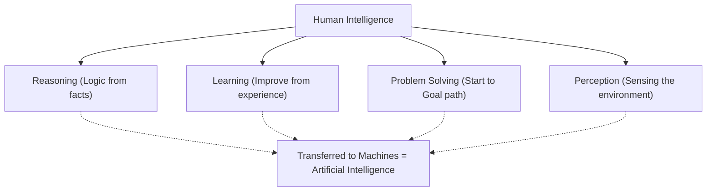

---

## 1.2 Relationship: AI, ML, Deep Learning & NLP (Venn Diagram)

Original notes ke Page 1 par ek bahut famous concentric Venn diagram bana hua hai. University exam mein yeh diagram examiner ka favorite hota hai!

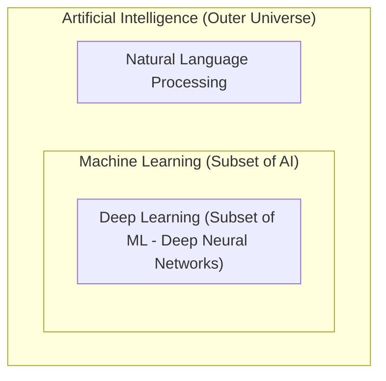

### Hinglish Breakdown of the Hierarchy:

1. **Artificial Intelligence (AI) - The Grandfather (Broadest Umbrella)**:
   - AI ek bohot bada domain hai jismein har woh technique aati hai jisse computer smart bane. Isme Rule-Based Systems (IF-ELSE rules), Search Algorithms, Fuzzy Logic, aur Machine Learning sab aate hain.
   - *Real-world*: Purane time ke Chess computer jo fixed rules par chalte the, woh bhi AI the.

2. **Machine Learning (ML) - The Father (Subset of AI)**:
   - ML kehta hai: "Bhai mujhe har ek step ka code manually mat likho! Mujhe bas bohot saara data do aur algorithm do, main data dekh kar khud pattern seekh lunga."
   - *Real-world*: Spam email filter. Lakhon spam aur non-spam emails dekh kar algorithm seekh jata hai ki kaunsa email spam hai.

3. **Deep Learning (DL) - The Child (Subset of ML)**:
   - Yeh ML ka hi advanced version hai jo human brain ke neurons se inspired hai (Artificial Neural Networks - ANN).
   - Jab data bohot massive ho (crores of images, videos, audio) aur features manually nikalna namumkin ho, tab Deep Learning use hoti hai.
   - *Real-world*: Face Unlock in smartphones, Autonomous driving (Tesla vision).

4. **Natural Language Processing (NLP) - The Overlapping Cousin**:
   - NLP computer ko insaani bhasha (English, Hindi, etc.) padhna, samajhna, aur bolna sikhata hai.
   - Diagram mein NLP ka aadha hissa ML/DL ke andar hai aur aadha baahar rule-based linguistics mein hai.
   - *Real-world*: ChatGPT, Google Translate, Siri/Alexa.

### 📊 Comparison Table: AI vs ML vs DL vs NLP

| Parameter | Artificial Intelligence (AI) | Machine Learning (ML) | Deep Learning (DL) | NLP |
| :--- | :--- | :--- | :--- | :--- |
| **Scope** | Complete field of smart machines | Subfield of AI focused on learning | Subfield of ML using Deep Neural Nets | Field dealing with human languages |
| **Dependency on Data** | Rule-based AI works with zero data | Needs structured data | Needs massive unstructured data | Needs text/speech corpora |
| **Human Intervention** | Requires manual rules & programming | Needs manual Feature Engineering | Automatically extracts features | Needs grammatical & semantic models |
| **Hardware Requirement** | Runs on standard CPUs | Normal CPUs/GPUs | High-end GPUs/TPUs needed | Standard to High GPUs (for LLMs) |
| **Classic Example** | A* search, Expert systems | Linear Regression, Decision Trees | Convolutional Neural Networks (CNN) | Sentiment Analysis, Chatbots |

---

## 1.3 Types of Artificial Intelligence (Page 2)

Original notes ke Page 2 par AI ko capabilities aur evolutionary stages ke basis par 4 types mein classify kiya gaya hai:

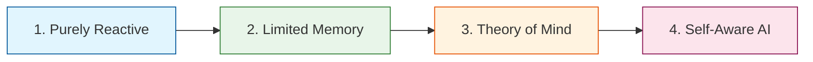

### 1. Purely Reactive AI (Sirf Abhi Ka Dekhta Hai)
- **Concept**: Is machine ke paas na koi Memory hoti hai, na koi past experience store hota hai. Yeh sirf "Current Scenario" (abhi kya ho raha hai) ko dekhta hai aur us par instant react karta hai.
- **Hinglish Analogy**: Jaise car ka ABS brake—woh yeh nahi dekhta ki 5 minute pehle car kahan thi, bas abhi pahiya slip ho raha hai toh turant brake pump karega!
- **Original Notes Example**: **Google's AlphaGo** & IBM's Deep Blue.
  - Deep Blue chess board ki current state dekhta hai aur best move chunta hai. Usse koi matlab nahi ki picchle game mein usne kya galti ki thi.
- **Limitation**: Past mistakes se seekh nahi sakta.

### 2. Limited Memory AI (Thoda Past Yaad Rakhta Hai)
- **Concept**: Yeh system past data ya experiences ko ek short time period ke liye store kar sakta hai aur unhe current decision making mein use karta hai.
- **Hinglish Analogy**: Tum bike chala rahe ho, tumne peeche aane wali car ko rearview mirror mein 2 second pehle dekha tha. Tumhe yaad hai ki car peeche hai, isliye bina dekhe achanak turn nahi loge.
- **Original Notes Example**: **Self-Driving Cars** (Tesla, Waymo).
  - Ek autonomous car doosri gaadi ki recent speed, direction, pedestrian ka movement track karti hai aur predict karti hai ki agle 3 seconds mein collision hoga ya nahi. Yeh saara data temporary memory mein store hota hai.
- **Current Status**: Aaj ki lagbhag saari modern AI (ChatGPT, recommendation engines, autonomous vehicles) isi category mein aati hain.

### 3. Theory of Mind AI (Insaani Jazbaat Samajhne Wali Machine)
- **Concept**: Psychology mein "Theory of Mind" ka matlab hota hai yeh samajhna ki saamne wale ke andar bhi feelings, emotions, beliefs aur thoughts hain.
- **AI Context**: Aisi AI jo insaano ke chehre ke expressions, aawaz ki tone, aur body language se unke emotions samajh sake aur unke sath socially interact kar sake.
- **Original Notes Example**: **Sophia the Robot** (Hanson Robotics).
  - Note: Original notes explicitly state: *"Yet to be built fully"*. Sophia basic emotional expressions dikha sakti hai, lekin actual human emotions ko internally feel ya fully comprehend nahi karti. Yeh abhi research phase mein hai.

### 4. Self-Aware AI (Khudi Ki Chetna / Consciousness)
- **Concept**: Future of AI (Super Intelligence). Ek aisi machine jiske paas khud ki consciousness, self-awareness, sentiments, aur desires honge.
- **Original Notes Mathematical Condition**:
  $$\text{Self-Aware Machines} \ge \text{Humans}$$
- **Hinglish Pop-Culture Reference (Directly from notes)**: **Chitti The Robot** (Movie: *Robot / Enthiran*). Jab Dr. Vaseegaran Chitti mein "Red Chip" daal deta hai, toh Chitti ko pyaar, gussa, jalan aur khud ko protect karne ki desire ho jati hai.
- **Current Status**: **Hypothetical Concept**. Aaj science ke paas aisi koi machine nahi hai jo self-aware ho.

### 📊 Comparison Table: 4 Types of AI

| Parameter | Purely Reactive | Limited Memory | Theory of Mind | Self-Aware AI |
| :--- | :--- | :--- | :--- | :--- |
| **Past Memory** | Absolutely None (Zero) | Short-term past storage | Understands mental models | Complete self-memory & ego |
| **Decision Base** | Current input only | Current input + Recent history | Beliefs, desires of humans | Self-interest & consciousness |
| **Emotions** | No | No | Can understand & emulate | Actually possesses feelings |
| **Status** | Fully Functional (AlphaGo) | Widely Deployed (Self-driving) | Early Experimental (Sophia) | Pure Sci-Fi / Hypothetical |

---

## 1.4 Future & Scope of AI (Page 3)

Original notes ke Page 3 par AI ke future application domains listed hain:

1. **Education**:
   - Personalized Learning: Har student ki learning speed alag hoti hai. AI tutor weak topics pehle padhayega aur strong topics jaldi skip karega.
   - Automated Grading: Exam sheets aur code plagiarism detection.
2. **Healthcare**:
   - Early Disease Detection: AI models MRI/CT scans dekh kar cancer ke early tumors detect kar rahe hain jo human eye miss kar sakti hai.
   - Robotic Surgery: Da Vinci surgical system se micro-level accuracy ke operation.
3. **Manufacturing**:
   - Predictive Maintenance: Factory machines kharab hone se pehle hi alert bhej deti hain.
   - Industrial Robotics: Car assembly plants mein 24/7 bina thake kaam karne wale robotic arms.
4. **Entertainment**:
   - Hyper-personalized Recommendations: Netflix aur YouTube ka recommendation engine jo wahi dikhata hai jo tumhe pasand aaye.
   - AI Generated Media: CGI, Deepfakes, AI music production.
5. **Defence**:
   - Autonomous Drones: Surveillance and precision strike systems.
   - Cyber Warfare: Real-time malware detection aur network security defending systems.

---

## 🎯 Unit 1 Exam Master Preparation

### 📝 Likely Exam Questions:
1. **Short (2 Marks)**: Define Artificial Intelligence. Mention its two primary subfields.
2. **Medium (5 Marks)**: Differentiate between Purely Reactive AI and Limited Memory AI with suitable real-world examples.
3. **Long (10 Marks)**: Draw and explain the relationship between AI, ML, Deep Learning, and NLP. Elaborate on the four evolutionary types of AI, stating which ones currently exist and which are hypothetical.

### 💡 High-Scoring University Definition (Reproduce this in exam):
> **Artificial Intelligence (AI)** is defined as a branch of computer science concerned with building smart machines capable of performing tasks that typically require human intelligence. These cognitive capabilities include reasoning, learning from past experience, problem-solving, and perception.

---
---

# 🤖 UNIT 2: Intelligent Agents & Architectures (Pages 3 - 6)

## 2.1 What is an Intelligent Agent?

### A. Ground Zero Concept
Bhai, imagine kar ek security guard college gate par khada hai:
1. Woh apni aankhon se dekhta hai ki kaun student bina ID card ke aa raha hai (Sensing / Perceiving).
2. Apne dimaag mein decide karta hai: "Isko andar aane doon ya rokoon?" (Decision Making).
3. Apne haath se gate band kar deta hai aur awaz lagata hai "Ruk ja bhai!" (Acting).

Artificial Intelligence mein har aisi cheez jo yeh 3 kaam kare, usse hum **Intelligent Agent** bolte hain!

### B. Core Architecture (Original Notes Diagram from Page 3)

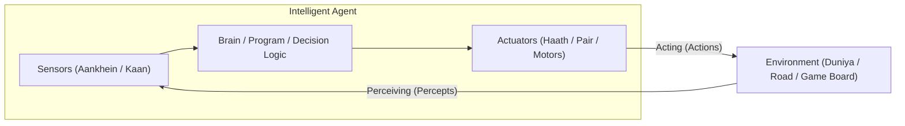

### Hinglish Technical Vocabulary:
- **Environment**: Woh duniya jismein agent rehta hai (e.g., road, chess board, human body).
- **Percept**: Kisi ek particular point of time par sensors ne jo input data capture kiya (e.g., camera frame, temperature reading).
- **Percept Sequence**: Shuru se lekar ab tak agent ne jitna bhi data sense kiya hai uski poori history.
- **Sensors**: Hardware ya software components jinke through agent environment se input leta hai (Cameras, LiDAR, Microphones, Keyboard input).
- **Actuators**: Components jinke through agent environment par actual physical ya software action perform karta hai (Motors, Wheels, Robotic Arms, Screen Display, Speakers).

### C. 3 Golden Rules from Original Notes:
1. **AI agent must be able to perceive the environment.** (Pehle dekhna/sunna padega).
2. **Make decision based on sensed data.** (Data ko process karke decision lena padega).
3. **Action must be generated & performed based on decision.** (Action actual environment par deliver karna padega).

### D. Goals of an Intelligent Agent:
- **High Performance**: Kaam fast aur accurate hona chahiye.
- **Best / Optimized Result**: Minimum resource (time/fuel/memory) mein maximum output.
- **Rational Action**: Rationality ka matlab hai: "Given the percept sequence and agent's built-in knowledge, take the action that maximizes the expected performance measure." (Hamesha sahi aur samajhdari bhara faisla lena).

---

## 2.2 The 5 Types of AI Agents (Pages 4 - 6)

University exam ka sabse bada 10-marks question: **"Explain the different types of intelligent agents with neat architectural block diagrams."**

Russell & Norvig ki AI taxonomy ke mutabiq notes mein 5 agents detail mein draw kiye gaye hain:

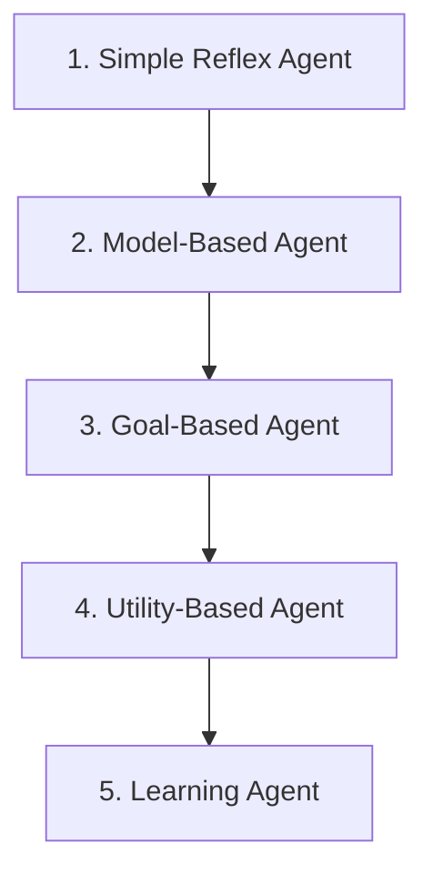

---

### 1. Simple Reflex Agent (Sirf Condition-Action Par Chalne Wala)

#### Concept & Original Notes Keywords:
- Operates on **Current Perception** only.
- Past history se koi lena dena nahi.
- Works on **Condition-Action Rules** (IF-THEN rules).
- Very limited intelligence.
- Operates only in **Fully Observable Environments**.

#### Architecture Block Diagram:
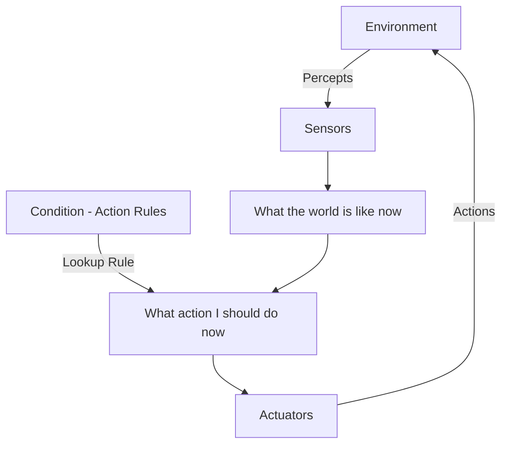

#### Real-World Example:
- **Automated Room Thermostat**:
  - `IF (Room Temperature > 25°C) THEN Turn ON Air Conditioner.`
  - `IF (Room Temperature < 20°C) THEN Turn OFF Air Conditioner.`
- Thermostat ko koi matlab nahi ki 1 ghante pehle temperature kya tha. Woh bas abhi ka sensor reading dekhta hai aur switch dabata hai.

#### Weakness:
Agar environment partially observable ho (matlab sensors ko sabkuch saaf na dikhe), toh Simple Reflex Agent **infinite loop** mein phas jata hai!

---

### 2. Model-Based Reflex Agent (Internal State / Memory Rakhne Wala)

#### Concept & Original Notes Keywords:
- Handles **Partially Observable Environments**.
- Maintains an **Internal State** (Apne dimaag mein duniya ka ek model/map bana kar rakhta hai).
- Stores **Percept History** (Pehle kya dekha tha yaad rakhta hai).
- Dimaag mein do cheezein track karta hai:
  1. *How the world evolves*: Duniya khud ba khud bina agent ke kaise change ho rahi hai.
  2. *What my actions do*: Mere kisi action ka duniya par kya asar padega.

#### Architecture Block Diagram:
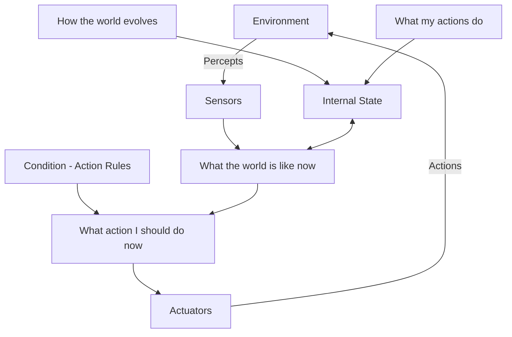

#### Real-World Example:
- **Self-Driving Car taking a Turn**:
  - Jab car turn le rahi hoti hai, blind spot mein agar ek bike chali gayi toh camera ko bike nahi dikh rahi (Partially Observable).
  - Lekin car ka *Internal State* model car ko batata hai: "Bhai, 2 second pehle bike right side thi, abhi camera mein nahi dikh rahi iska matlab gayab nahi hui, woh blind spot mein hai! Right turn mat lo!"

---

### 3. Goal-Based Agent (Apni Manzil / Goal Ko Dekh Kar Chalne Wala)

#### Concept & Original Notes Keywords:
- **Goal**: Description of a desirable situation (Mujhe kahan pahunchna hai).
- Yeh sirf IF-THEN par nahi chalta, yeh aage ki sochta hai using **Searching & Planning**.
- Decision lene se pehle evaluate karta hai: *"What it will be like if I do action A?"* (Agar main action A loon, toh kya main apne Goal ke kareeb pahunchunga?).

#### Architecture Block Diagram:
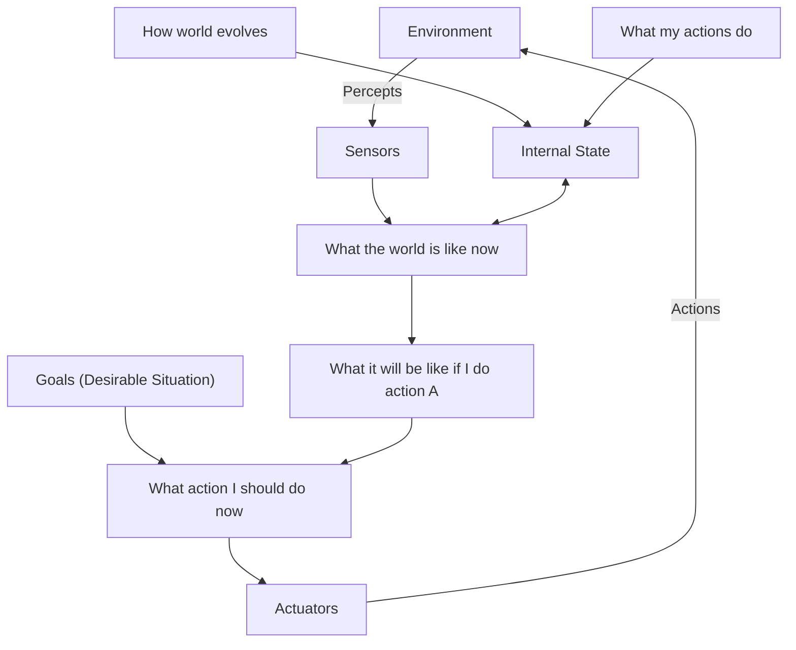

#### Real-World Example:
- **Google Maps Navigation**:
  - Current location se Goal (College) tak pahunchna hai.
  - Har mod par agent dekhta hai: "Agar main left loon toh 5 km bacha, right loon toh 10 km bacha." Agent wahi action lega jo usse Goal ke paas le jaye.

---

### 4. Utility-Based Agent (Sabse Best / Khushiyon Bhara Rasta Chunta Hai)

#### Concept & Original Notes Keywords:
- Goal-based agent sirf yeh dekhta hai ki *goal mila ya nahi* (Success/Failure - binary).
- Lekin agar Goal tak pahunchne ke **Multiple Options** hon, tab kaunsa rasta chunein?
- Tab use hota hai **Utility Function**!
- Original notes exact definition: **"Utility describes how happy the agent is."**
- Utility ka matlab hai measure of success (time, fuel, comfort, money, safety).

#### Architecture Block Diagram:
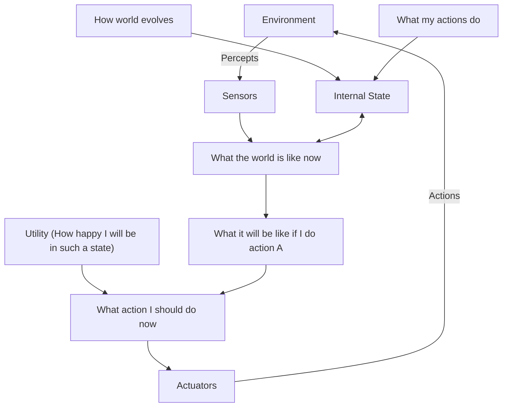

#### Real-World Example:
- **Cab Booking / Flight Route Optimizer**:
  - Goal: Delhi se Mumbai pahunchna.
  - Option 1: Flight - ₹5000, 2 ghante (High speed, moderate cost) $
ightarrow$ Utility = 9/10.
  - Option 2: Train - ₹1500, 16 ghante (Low cost, slow speed) $
ightarrow$ Utility = 6/10.
  - Option 3: Walking - ₹0, 20 din (Zero cost, infinite pain) $
ightarrow$ Utility = 0/10.
  - Utility-based agent tradeoffs (time vs money vs safety) balance karke highest utility wala option choose karta hai.

---

### 5. Learning Agent (Past Experience Se Seekh Kar Ustaad Banne Wala)

#### Concept & Original Notes Keywords:
- Ek aisa agent jo anjaan (unknown) environment mein enter karta hai aur time ke sath seekh kar apne aap ko improve karta hai.
- Original notes ke mutabiq iske **4 Distinct Functional Components** hote hain:

1. **Critic**:
   - Yeh bahar ke *Performance Standards* se feedback leta hai aur agent ko batata hai: "Bhai tu kaisa perform kar raha hai? Acha ya bura?"
2. **Learning Element**:
   - Yeh Critic se feedback lekar naya knowledge generate karta hai aur improvements suggest karta hai.
3. **Performance Element**:
   - Yeh actual purana agent hai jo decisions leta hai aur environment par actions perform karta hai.
4. **Problem Generator**:
   - Yeh agent ko nayi experiments aur exploratory actions suggest karta hai taaki agent out-of-the-box nayi strategies seekh sake.

#### Architecture Block Diagram (Exact Replica of Page 6):
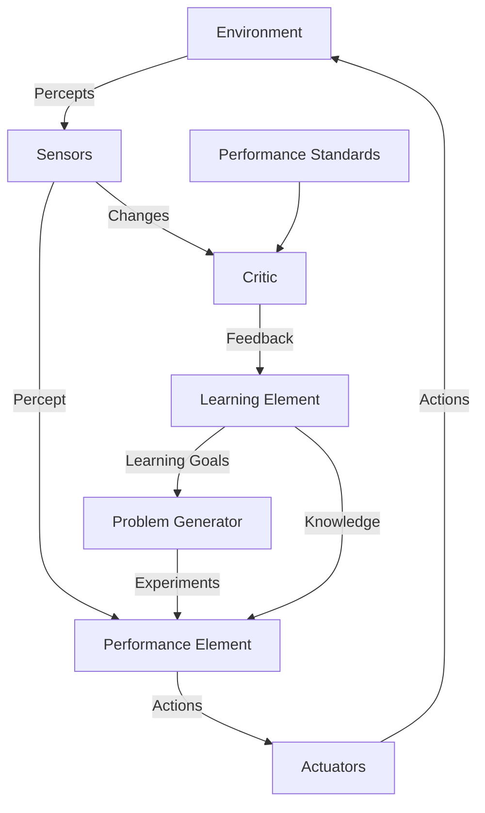

#### Real-World Example:
- **Autonomous Chess Agent (AlphaZero) / Self-Driving Car**:
  - Car jab kisi gaddhe (pothole) par tezi se chali jati hai, Critic negative feedback deta hai. Learning element rule update karta hai: "Aage se black patch dekhte hi slow karna." Problem Generator alag-alag mausam (rain, fog) mein test drives plan karta hai.

---

### 📊 Master Comparison Table: All 5 Intelligent Agents

| Feature | Simple Reflex | Model-Based | Goal-Based | Utility-Based | Learning Agent |
| :--- | :--- | :--- | :--- | :--- | :--- |
| **Memory** | None | Yes (Internal State) | Yes (State + Goal) | Yes (State + Utility) | Yes (Experience Base) |
| **Environment Type**| Fully Observable | Partially Observable | Partially Observable | Partially Observable| Unknown & Dynamic |
| **Decision Rule** | Condition-Action | Condition-Action + State | Planning towards Goal | Maximizing Happiness/Utility | Experiential Improvement |
| **Adaptability** | Fixed / Rigid | Fixed Model | Goal-oriented | Trade-off Balancer | High Self-Adaptation |
| **Complexity** | Lowest | Low to Medium | Medium to High | High | Highest |

---

## 🎯 Unit 2 Exam Master Preparation

### 📝 Likely Exam Questions:
1. **Short (2 Marks)**: What is an Actuator? Give two examples in robotics.
2. **Medium (5 Marks)**: Contrast Goal-Based Agents with Utility-Based Agents. Why is a utility function necessary when goals already exist?
3. **Long (10 Marks)**: Draw and explain the architectural block diagram of a Learning Agent. Explain the roles of Critic, Learning Element, Performance Element, and Problem Generator in detail.

---
---

# 🌍 UNIT 3: Environments in Artificial Intelligence (Page 7)

## 3.1 Understanding AI Environments

Bhai, intelligent agent bina environment ke kuch nahi hai. Car ke liye road uska environment hai, chess program ke liye 64-squares ka board environment hai, aur trading bot ke liye stock exchange uska environment hai.

Original notes ke Page 7 par environment ko **7 fundamental properties (dimensions)** mein divide kiya gaya hai:

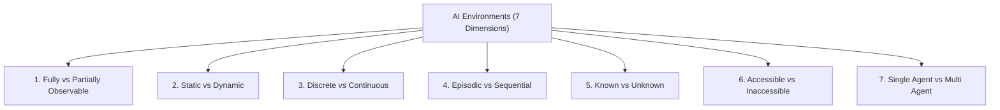

---

### 1. Fully Observable vs Partially Observable
- **Fully Observable (Sabkuch Saaf Dikh raha hai)**:
  - Agent ke sensors environment ki complete state ko har point of time par accurately dekh sakte hain. Agent ko kuch guess karne ki zaroorat nahi.
  - *Example*: **Chess**. Dono players ko board par rakhi har piece ki position 100% dikhai deti hai.
- **Partially Observable (Parda laga hua hai / Kuch chupa hua hai)**:
  - Sensors environment ki puri state capture nahi kar pate due to noise, distance, ya hidden cards. Agent ko memory aur prediction use karni padti hai.
  - *Example*: **Poker** (saamne wale ke cards chupe hain), **Self-Driving Car in Heavy Fog** (fog ki wajah se 50 meter aage ka rasta nahi dikh raha).

### 2. Static vs Dynamic
- **Static Environment (Waqt ruk gaya hai)**:
  - Jab agent apna decision soch raha hota hai, tab environment change nahi hota. Environment tabhi badalta hai jab agent action leta hai.
  - *Example*: **Crossword Puzzle**, **Sudoku**. Tum 1 ghante tak sochte raho, puzzle waisi ki waisi rahegi.
- **Dynamic Environment (Waqt kisi ka intezar nahi karta)**:
  - Agent soch hi raha hota hai aur environment peeche se badal jata hai! Agent ko continuously watch aur react karna padta hai.
  - *Example*: **Driving on a Highway**. Agar tum 5 second sochte rahe ki steering ghumana hai ya nahi, tab tak car kisi ped mein thuk chuki hogi!

### 3. Discrete vs Continuous
- **Discrete Environment (Ginti ke fixed states aur actions)**:
  - States, actions, aur time ke distinct, separate values hote hain.
  - *Example*: **Chess**. Fixed 64 squares hain, moves fixed hain (Knight 'L' shape chalega), time turns mein measure hota hai.
- **Continuous Environment (Infinite possibilities / Decimal points)**:
  - Variables smooth scale par continuously vary karte hain (speed, angle, temperature).
  - *Example*: **Car Driving**. Speed 40 km/h se 40.001 km/h ho sakti hai, steering angle continuous degree par rotate hota hai.

### 4. Episodic vs Sequential
- **Episodic Environment (Pichla sab bhool jao / Har episode fresh hai)**:
  - Agent ka current decision sirf current episode par depend karta hai. Aaj liye gaye action ka kal ke episode par koi effect nahi padega.
  - *Example*: **Defective Part Sorting Robot on Assembly Line**. Robot ek bottle dekhta hai: defective hai toh pick karke dustbin mein phenka. Agli bottle aayi, woh nayi episode hai. Pichli bottle dustbin mein gayi thi usse agli bottle par koi farak nahi padta.
- **Sequential Environment (Jaisi karni waisi bharni / Past decisions impact future)**:
  - Current action future ke saare states aur decisions ko affect karega.
  - *Example*: **Chess** ya **Stock Market Trading**. Agar shuruat mein Queen marwa di, toh endgame mein uska bhari nuksan jhelna padega!

### 5. Known vs Unknown
- **Known Environment (Rules of the game maloom hain)**:
  - Environment ke saare rules, physics, aur transition probabilities agent ko pehle se pata hote hain.
  - *Example*: **Solitaire card game**. Rules pehle se fixed aur known hain.
- **Unknown Environment (Naye shehar mein bina map ke)**:
  - Agent ko environment ke rules pata nahi hote; usse explore karke seekhna padta hai (Trial and Error).
  - *Example*: **Naye planet (Mars) par utra hua Rover**. Usko nahi pata ki aage mitti kitni geeli ya slippery hai.

### 6. Accessible vs Inaccessible
- *Note*: Accessible/Inaccessible ka concept Fully/Partially Observable se bohot similar hota hai.
- **Accessible**: Agent environment ke har aspect ko apne sensors se directly access kar sakta hai.
- **Inaccessible**: Environment ke bohot se variables sensor reach se bahar hote hain.

### 7. Single Agent vs Multi-Agent
- **Single Agent (Akela hero)**:
  - Environment mein sirf ek hi agent decision le raha hai. Aas-paas doosri entities koi strategic dimaag nahi chala rahi.
  - *Example*: **Crossword Puzzle solver**, **Cleaning Robot in an empty room**.
- **Multi-Agent (Aamne-saamne ki ladai / Teamwork)**:
  - Multiple agents aas-paas hote hain jo ek doosre ke decisions ko affect karte hain.
  - *Competitive Multi-Agent*: Chess (Opponent tumhe harana chahta hai).
  - *Cooperative Multi-Agent*: Automated delivery drones communicating with each other to avoid mid-air collisions.

---

## 3.2 📊 Master Environment Classification Grid

University exams mein 5-mark question aata hai: **"Classify the following tasks according to AI environment properties."** Is table ko ghot kar pee jao!

| Task / Environment | Observable | Deterministic | Episodic | Static | Discrete | Agents |
| :--- | :--- | :--- | :--- | :--- | :--- | :--- |
| **Chess with Clock** | Fully | Deterministic | Sequential | Semi (clock runs) | Discrete | Multi-Agent (Competitive) |
| **Poker** | Partially | Stochastic | Sequential | Static | Discrete | Multi-Agent (Competitive) |
| **Self-Driving Car** | Partially | Stochastic | Sequential | Dynamic | Continuous | Multi-Agent |
| **Medical Diagnosis**| Partially | Stochastic | Sequential | Dynamic | Continuous | Single Agent |
| **Vacuum Cleaner Robot**| Partially | Stochastic | Sequential | Dynamic | Continuous | Single Agent |
| **Image Analysis** | Fully | Deterministic | Episodic | Semi | Discrete | Single Agent |

---

## 3.3 The PEAS Framework (Exam Favorite Concept)

Bhai, environment design karte waqt AI engineers **PEAS** framework use karte hain:
- **P** $
ightarrow$ **Performance Measure**: Agent ki kamyabi kis metric se naapoge? (Speed, safety, score)
- **E** $
ightarrow$ **Environment**: Agent kahan operate karega? (Roads, website, hospital)
- **A** $
ightarrow$ **Actuators**: Agent action kaise deliver karega? (Steering, screen display, syringe)
- **S** $
ightarrow$ **Sensors**: Agent data kaise capture karega? (Cameras, GPS, keyboard)

### Example: PEAS for Self-Driving Taxi
- **P**: Safety, speed, legal drive, comfort, profit maximization.
- **E**: City roads, pedestrians, other vehicles, traffic signals, weather.
- **A**: Steering wheel, accelerator, brake, horn, turn indicators.
- **S**: Video cameras, LiDAR, radar, GPS, speedometer, odometer, engine sensors.

---

## 🎯 Unit 3 Exam Master Preparation

### 📝 Likely Exam Questions:
1. **Short (2 Marks)**: What is the difference between Static and Dynamic environments?
2. **Medium (5 Marks)**: Write the PEAS specification for an Automated Vacuum Cleaner robot.
3. **Long (10 Marks)**: Explain the 7 dimensions of AI environments in detail. Classify (a) Chess, (b) Autonomous Driving, and (c) Medical Diagnosis under these dimensions.


---

# 🧮 UNIT 4: Fuzzy Logic & Fuzzy Systems (Pages 7 - 13)

## 4.1 Introduction & Historical Genesis

### A. Ground Zero Concept
Bhai, bachpan se computer mein hume ek hi cheez sikhayi gayi hai: **Binary Logic** ya **Boolean Logic** (Sirf 0 ya 1, True ya False, Black ya White).
- Light switch ya toh ON hai ya OFF.
- Number ya toh Even hai ya Odd.
- Candidate ya toh Pass hai ya Fail.

Lekin real world itna seedha aur simple nahi hota! Real world mein zyadatar cheezein "Grey" hoti hain:
- Agar koi pooche: *"Kya aaj mausam garam hai?"*
  - Boolean logic bolega: "Sirf 0 ya 1 mein jawab do!"
  - Lekin insaan bolega: *"Bhai halki-halki dhoop hai, bohot zyada garam nahi hai, medium sa hai."*
- Agar koi pooche: *"Kya Rahul honest insaan hai?"*
  - Koi 100% devta nahi hota aur na hi 100% shaitan. Insaan bolta hai: *"Rahul mostly honest hai (say 80% honest)."*

Isi human reasoning aur real-world **Uncertainty (Anishchitta)** ko mathematics mein dhaalne ke liye invent hua: **FUZZY LOGIC**!

### B. The Father of Fuzzy Logic (Original Notes Keyword)
- **Lotfi A. Zadeh** (Professor at UC Berkeley) ne **1965** mein Fuzzy Sets ka revolutionary concept diya tha.
- Original notes ke Page 7 par clearly likha hai:
  $$\text{Father of FL} : \text{Lotfi Zadeh}$$

### C. Evolution of Logic in AI:
Original notes show this progression:
$$\text{Boolean Logic} \longrightarrow \text{Relational Logic} \longrightarrow \text{Predicate Logic} \longrightarrow \text{Fuzzy Logic (Deals with Fuzzy Sets / Fuzzy Algebra)}$$

---

## 4.2 Crisp Logic vs. Fuzzy Logic (Page 8)

Original notes ke Page 8 par ek bohot pyara comparative diagram bana hai:

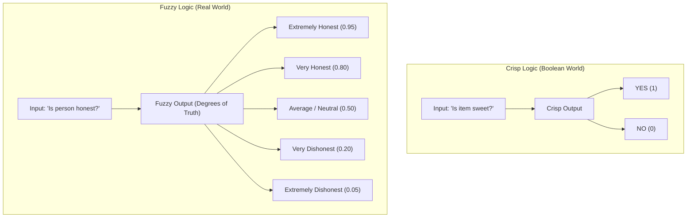

### 📊 Comparison Table: Crisp Logic vs. Fuzzy Logic

| Parameter | Crisp Logic (Classical Logic) | Fuzzy Logic |
| :--- | :--- | :--- |
| **Truth Values** | Strictly Binary: $\{0, 1\}$ | Infinite values in range $[0, 1]$ |
| **Boundary** | Sharp, crisp, and well-defined | Vague, smooth, and overlapping |
| **Membership** | An element either belongs ($1$) or doesn't ($0$) | An element has a degree of membership $\mu(x) \in [0, 1]$ |
| **Handling Uncertainty**| Fails when inputs are ambiguous | Specifically designed for ambiguity & human reasoning |
| **Real-world Modeling**| Idealized mathematical machines | Washing machines, Air conditioners, ABS brakes |

---

## 4.3 Crisp Sets vs. Fuzzy Sets & Membership Functions (Pages 8 - 9)

### A. Crisp Set Formulation (Original Notes Page 8)
- Let Universal Set $U$ = All college students.
- Set $A$ = Students in 10th grade.
- Set $B$ = Students in 12th grade.
- Yahan boundary 100% clear hai. Agar koi student 10th mein padhta hai, toh woh $A$ ka member hai (Membership = $1$). Woh adha 10th aur adha 12th mein nahi ho sakta.
$$\mu_A(x) = \begin{cases} 1 & \text{if } x \in A \\ 0 & \text{if } x \notin A \end{cases}$$

### B. Fuzzy Set Formulation (Original Notes Page 8)
- Let Universal Set $U$ = All students in a class.
- Fuzzy Set $G$ = Set of **"Good Students"**.
- Fuzzy Set $B$ = Set of **"Bad Students"**.
- Ab "Good" hone ki koi fixed cutoff nahi hoti! Har student ki performance ke mutabiq uski ek **Membership Degree $\mu(x)$** hogi between $0$ and $1$.

Original notes representation:
$$G = \{G, \mu(G)\} \quad \text{where } \mu(G) = \text{Degree of Membership (Membership Function - MF)}$$
$$G = \{(A, 0.9), (B, 0.7)\}$$
$$B = \{(A, 0.1), (B, 0.3)\}$$
- Student $A$ 90% good ($0.9$) aur 10% bad ($0.1$) hai.
- Student $B$ 70% good ($0.7$) aur 30% bad ($0.3$) hai.

---

## 4.4 Features of a Membership Function (Page 9)

Original notes ke Page 9 par 3 geometric components define kiye gaye hain. Yeh university exam mein 5-mark numerical / definition question banta hai!

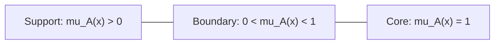

### 1. Support of a Fuzzy Set $A$:
- **Definition**: Universal set ke un saare points $x$ ka set jinki membership value strictly zero se badi ho.
- **Mathematical Formula**:
  $$\text{Support}(A) = \{x \in U \mid \mu_A(x) > 0\}$$
- *Hinglish*: Jismein thoda sa bhi sachhai ka ansh hai, chahe woh $0.001$ hi kyun na ho!

### 2. Core of a Fuzzy Set $A$:
- **Definition**: Universal set ke un saare points $x$ ka set jinki membership value exact **$1$** hoti hai (100% full membership).
- **Mathematical Formula**:
  $$\text{Core}(A) = \{x \in U \mid \mu_A(x) = 1\}$$
- *Hinglish*: Jo 100% pakka us set ka hissa hain. Diagram mein trapezoid ka flat top hissa Core hota hai.

### 3. Boundary of a Fuzzy Set $A$:
- **Definition**: Un saare points ka set jahan membership value $0$ se badi lekin $1$ se choti hoti hai.
- **Mathematical Formula**:
  $$\text{Boundary}(A) = \{x \in U \mid 0 < \mu_A(x) < 1\}$$
- *Hinglish*: Sloping walls of the trapezoid/triangle jahan uncertainty hai (transition state).

---

## 4.5 The 10 Fuzzy Logic Operations (Pages 10 - 11) - Complete Numerical Derivation

Original notes ke Page 10 aur 11 par do standard fuzzy sets diye gaye hain aur 10 operations solve kiye gaye hain. Exam mein yahi exact problem aati hai!

### 🎯 Given Standard Sets from Notes:
$$A = \{(x_1, 0.6), (x_2, 0.7), (x_3, 0.4)\}$$
$$B = \{(x_1, 0.3), (x_2, 0.2), (x_3, 0.5)\}$$

Bhai, ab har operation ko step-by-step solve karte hain:

---

### (1) Fuzzy Union ($A \cup B$) - Maximum Operator
- **Formula**:
  $$\mu_{A \cup B}(x) = \max(\mu_A(x), \mu_B(x))$$
- **Calculation**:
  - For $x_1$: $\max(0.6, 0.3) = 0.6$
  - For $x_2$: $\max(0.7, 0.2) = 0.7$
  - For $x_3$: $\max(0.4, 0.5) = 0.5$
- **Result**:
  $$A \cup B = \{(x_1, 0.6), (x_2, 0.7), (x_3, 0.5)\}$$

---

### (2) Fuzzy Intersection ($A \cap B$) - Minimum Operator
- **Formula**:
  $$\mu_{A \cap B}(x) = \min(\mu_A(x), \mu_B(x))$$
- **Calculation**:
  - For $x_1$: $\min(0.6, 0.3) = 0.3$
  - For $x_2$: $\min(0.7, 0.2) = 0.2$
  - For $x_3$: $\min(0.4, 0.5) = 0.4$
- **Result**:
  $$A \cap B = \{(x_1, 0.3), (x_2, 0.2), (x_3, 0.4)\}$$

---

### (3) Fuzzy Complement ($A^C$ and $B^C$) - Negation Operator
- **Formula**:
  $$\mu_{A^C}(x) = 1 - \mu_A(x)$$
- **Calculation for $A^C$**:
  - For $x_1$: $1 - 0.6 = 0.4$
  - For $x_2$: $1 - 0.7 = 0.3$
  - For $x_3$: $1 - 0.4 = 0.6$
  $$A^C = \{(x_1, 0.4), (x_2, 0.3), (x_3, 0.6)\}$$
- **Calculation for $B^C$**:
  - For $x_1$: $1 - 0.3 = 0.7$
  - For $x_2$: $1 - 0.2 = 0.8$
  - For $x_3$: $1 - 0.5 = 0.5$
  $$B^C = \{(x_1, 0.7), (x_2, 0.8), (x_3, 0.5)\}$$

---

### (4) Vector Product / Algebraic Product ($A \cdot B$)
- **Formula**:
  $$\mu_{A \cdot B}(x) = \mu_A(x) \times \mu_B(x)$$
- **Calculation**:
  - For $x_1$: $0.6 \times 0.3 = 0.18$
  - For $x_2$: $0.7 \times 0.2 = 0.14$
  - For $x_3$: $0.4 \times 0.5 = 0.20$
- **Result**:
  $$A \cdot B = \{(x_1, 0.18), (x_2, 0.14), (x_3, 0.20)\}$$

---

### (5) Scalar Product ($\alpha \times A$)
- **Formula**:
  $$\mu_{\alpha A}(x) = \alpha \times \mu_A(x) \quad (\text{where } 0 < \alpha \le 1)$$
- *Example* (Let $\alpha = 0.5$):
  - For $x_1$: $0.5 \times 0.6 = 0.30$
  - For $x_2$: $0.5 \times 0.7 = 0.35$
  - For $x_3$: $0.5 \times 0.4 = 0.20$
  $$\alpha A = \{(x_1, 0.30), (x_2, 0.35), (x_3, 0.20)\}$$

---

### (6) Equality of Two Fuzzy Sets ($A = B$)
- **Condition**:
  $$A = B \iff \mu_A(x) = \mu_B(x) \quad \forall x \in U$$
- *Analysis*: Yahan $x_1$ par $0.6 \ne 0.3$, isliye $A \ne B$.

---

### (7) Power of a Fuzzy Set ($A^\alpha$) - Concentration / Dilation
- **Formula**:
  $$\mu_{A^\alpha}(x) = (\mu_A(x))^\alpha$$
- *Special Exam Terms*:
  - Agar $\alpha = 2$, isse **Concentration** bolte hain (e.g., "Very Sweet"). Membership values square hokar choti ho jati hain.
  - Agar $\alpha = 0.5$, isse **Dilation** bolte hain (e.g., "More or Less Sweet"). Membership values square-root hokar badh jati hain.
- *Calculation for $\alpha = 2$*:
  - For $x_1$: $(0.6)^2 = 0.36$
  - For $x_2$: $(0.7)^2 = 0.49$
  - For $x_3$: $(0.4)^2 = 0.16$
  $$A^2 = \{(x_1, 0.36), (x_2, 0.49), (x_3, 0.16)\}$$

---

### (8) Algebraic Sum ($A + B$)
- **Formula**:
  $$\mu_{A + B}(x) = \mu_A(x) + \mu_B(x) - (\mu_A(x) \cdot \mu_B(x))$$
- **Calculation**:
  - For $x_1$: $0.6 + 0.3 - (0.18) = 0.90 - 0.18 = 0.72$
  - For $x_2$: $0.7 + 0.2 - (0.14) = 0.90 - 0.14 = 0.76$
  - For $x_3$: $0.4 + 0.5 - (0.20) = 0.90 - 0.20 = 0.70$
- **Result**:
  $$A + B = \{(x_1, 0.72), (x_2, 0.76), (x_3, 0.70)\}$$

---

### (9) Algebraic Difference ($A - B$)
- **Formula**:
  $$\mu_{A - B}(x) = \mu_{A \cap B^C}(x) = \min(\mu_A(x), \mu_{B^C}(x)) = \min(\mu_A(x), 1 - \mu_B(x))$$
- **Calculation** (Using previously computed $B^C = \{(x_1, 0.7), (x_2, 0.8), (x_3, 0.5)\}$):
  - For $x_1$: $\min(0.6, 0.7) = 0.6$
  - For $x_2$: $\min(0.7, 0.8) = 0.7$
  - For $x_3$: $\min(0.4, 0.5) = 0.4$
- **Result**:
  $$A - B = \{(x_1, 0.6), (x_2, 0.7), (x_3, 0.4)\} = A$$

---

### (10) Disjunctive Sum / Bounded Difference ($A \oplus B$)
- **Formula**:
  $$\mu_{A \oplus B}(x) = \mu_{(A^C \cap B) \cup (A \cap B^C)}(x) = \max[\min(1 - \mu_A, \mu_B), \min(\mu_A, 1 - \mu_B)]$$
- **Step 1: Compute $(A^C \cap B)$**:
  - For $x_1$: $\min(0.4, 0.3) = 0.3$
  - For $x_2$: $\min(0.3, 0.2) = 0.2$
  - For $x_3$: $\min(0.6, 0.5) = 0.5$
  $$(A^C \cap B) = \{(x_1, 0.3), (x_2, 0.2), (x_3, 0.5)\}$$
- **Step 2: Compute $(A \cap B^C)$**:
  $$(A \cap B^C) = \{(x_1, 0.6), (x_2, 0.7), (x_3, 0.4)\}$$
- **Step 3: Take Union ($\\max$) of Step 1 & Step 2**:
  - For $x_1$: $\max(0.3, 0.6) = 0.6$
  - For $x_2$: $\max(0.2, 0.7) = 0.7$
  - For $x_3$: $\max(0.5, 0.4) = 0.5$
- **Result**:
  $$A \oplus B = \{(x_1, 0.6), (x_2, 0.7), (x_3, 0.5)\}$$

---

## 4.6 Properties of Fuzzy Sets (Page 12)

Original notes ke Page 12 par classical set theory ke 6 laws fuzzy sets par verify kiye gaye hain:

1. **Commutative Law**:
   $$A \cap B = B \cap A \quad \text{and} \quad A \cup B = B \cup A$$
2. **Associative Law**:
   $$A \cup (B \cup C) = (A \cup B) \cup C \quad \text{and} \quad A \cap (B \cap C) = (A \cap B) \cap C$$
3. **Distributive Law**:
   $$A \cup (B \cap C) = (A \cup B) \cap (A \cup C) \quad \text{and} \quad A \cap (B \cup C) = (A \cap B) \cup (A \cap C)$$
4. **Idempotence Law**:
   $$A \cup A = A, \quad A \cap A = A, \quad A \cup \phi = A, \quad A \cap \phi = \phi$$
5. **Transitive Law**:
   $$\text{If } A \subseteq B \text{ and } B \subseteq C, \text{ then } A \subseteq C$$
6. **De Morgan's Laws**:
   $$(A \cap B)^C = A^C \cup B^C \quad \text{and} \quad (A \cup B)^C = A^C \cap B^C$$

> ⚠️ **CRITICAL EXAM ALERT (Law of Excluded Middle)**:
> Classical logic mein $A \cup A^C = U$ (Universal Set) aur $A \cap A^C = \phi$ (Empty set) hota hai.  
> **Lekin Fuzzy Logic mein yeh true nahi hota!**  
> $A \cup A^C \ne U$ and $A \cap A^C \ne \phi$ because fuzzy sets have overlapping boundaries!

---

## 4.7 Fuzzy Relations & Cartesian Product (Page 12) - Complete Step-by-Step Matrix

Original notes ke Page 12 par do alag universes ke fuzzy sets diye gaye hain aur unka relation matrix $R = A \times B$ calculate kiya gaya hai.

### 🎯 Given Sets:
$$A = \{(x_1, 0.6), (x_2, 0.2), (x_3, 0.3)\}$$
$$B = \{(y_1, 0.7), (y_2, 0.3), (y_3, 0.4)\}$$

### Formula for Fuzzy Cartesian Product:
$$\mu_R(x, y) = \mu_{A \times B}(x, y) = \min(\mu_A(x), \mu_B(y))$$

### Cell-by-Cell Calculation:
- **Row 1 ($x_1 = 0.6$)**:
  - With $y_1 (0.7)$: $\min(0.6, 0.7) = 0.6$
  - With $y_2 (0.3)$: $\min(0.6, 0.3) = 0.3$
  - With $y_3 (0.4)$: $\min(0.6, 0.4) = 0.4$
- **Row 2 ($x_2 = 0.2$)**:
  - With $y_1 (0.7)$: $\min(0.2, 0.7) = 0.2$
  - With $y_2 (0.3)$: $\min(0.2, 0.3) = 0.2$
  - With $y_3 (0.4)$: $\min(0.2, 0.4) = 0.2$
- **Row 3 ($x_3 = 0.3$)**:
  - With $y_1 (0.7)$: $\min(0.3, 0.7) = 0.3$
  - With $y_2 (0.3)$: $\min(0.3, 0.3) = 0.3$
  - With $y_3 (0.4)$: $\min(0.3, 0.4) = 0.3$

### Final Relation Matrix $R = A \times B$:
$$R = \begin{pmatrix} & y_1 & y_2 & y_3 \\ x_1 & 0.6 & 0.3 & 0.4 \\ x_2 & 0.2 & 0.2 & 0.2 \\ x_3 & 0.3 & 0.3 & 0.3 \end{pmatrix}$$

---

## 4.8 Fuzzy IF-THEN Rules & Real-World Application (Page 13)

### A. Linguistic Variables & Rule Formulation
Fuzzy systems rule-based reasoning par chalte hain:
$$\text{IF } (\text{Premise / Antecedent } A) \quad \text{THEN} \quad (\text{Conclusion / Consequent } B)$$
Original notes problem:
**"IF Temperature is High THEN Pressure is Low"**

### 🎯 Given Sets from Notes:
- $T_{\text{High}} = \{(25, 0.1), (30, 0.2), (35, 0.5), (40, 0.6)\}$ (Temperature in °C)
- $P_{\text{Low}} = \{(2, 0.3), (5, 0.5), (6, 0.4)\}$ (Pressure in bar)

### Computing Rule Matrix $R = T_{\text{High}} \longrightarrow P_{\text{Low}}$ using Mamdani Min Implication:
$$R(t, p) = \min(\mu_{T_{\text{High}}}(t), \mu_{P_{\text{Low}}}(p))$$

| Temp \ Press | $p=2$ ($0.3$) | $p=5$ ($0.5$) | $p=6$ ($0.4$) |
| :--- | :--- | :--- | :--- |
| **$t=25$ ($0.1$)** | $\min(0.1, 0.3) = \mathbf{0.1}$ | $\min(0.1, 0.5) = \mathbf{0.1}$ | $\min(0.1, 0.4) = \mathbf{0.1}$ |
| **$t=30$ ($0.2$)** | $\min(0.2, 0.3) = \mathbf{0.2}$ | $\min(0.2, 0.5) = \mathbf{0.2}$ | $\min(0.2, 0.4) = \mathbf{0.2}$ |
| **$t=35$ ($0.5$)** | $\min(0.5, 0.3) = \mathbf{0.3}$ | $\min(0.5, 0.5) = \mathbf{0.5}$ | $\min(0.5, 0.4) = \mathbf{0.4}$ |
| **$t=40$ ($0.6$)** | $\min(0.6, 0.3) = \mathbf{0.3}$ | $\min(0.6, 0.5) = \mathbf{0.5}$ | $\min(0.6, 0.4) = \mathbf{0.4}$ |

$$R = \begin{pmatrix} & 2 & 5 & 6 \\ 25 & 0.1 & 0.1 & 0.1 \\ 30 & 0.2 & 0.2 & 0.2 \\ 35 & 0.3 & 0.5 & 0.4 \\ 40 & 0.3 & 0.5 & 0.4 \end{pmatrix}$$

---

## 4.9 Fuzzification and Defuzzification Architecture (Page 13)

Original notes ke bottom par complete Fuzzy Logic Controller (FLC) ka pipeline diagram bana hai:

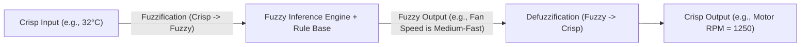

### Hinglish Step-by-Step Breakdown:
1. **Crisp Input**: Real-world sensor se aane wala exact number (e.g., Temperature sensor = $32^\circ\text{C}$).
2. **Fuzzification**: Is crisp number ko linguistic fuzzy sets mein convert karna (e.g., $32^\circ\text{C}$ is 60% Warm and 40% Hot).
3. **Fuzzy Inference Engine & Rule Base**: "IF-THEN" rules evaluate hote hain aur output fuzzy set banta hai.
4. **Defuzzification**: Is resulting fuzzy shape ko wapas ek single executable crisp number mein convert karna (e.g., Centroid Method / Center of Gravity use karke AC ka fan speed $1250\text{ RPM}$ set karna).

---

## 🎯 Unit 4 Exam Master Preparation

### 📝 Likely Exam Questions:
1. **Short (2 Marks)**: Define Support and Core of a fuzzy set with equations.
2. **Medium (5 Marks)**: Given $A = \{(x_1, 0.6), (x_2, 0.7)\}$ and $B = \{(x_1, 0.4), (x_2, 0.5)\}$. Compute $A \cup B$, $A \cap B$, and algebraic sum $A + B$.
3. **Long (10 Marks)**: Explain the architecture of a Fuzzy Logic System with a block diagram. What are the roles of Fuzzification and Defuzzification? Solve the fuzzy relation $R = A \times B$ for given fuzzy sets.

---
---

# 🔍 UNIT 5: Problem Solving & Search Algorithms (Pages 14 - 27)

Bhai, ab hum aa gaye hain Artificial Intelligence ke sabse important aur highest-weightage unit par! University exam ka 20-25 marks ka paper akele is unit se banta hai!

## 5.1 Problem Solving & State Space Search Formulation (Page 14)

### A. Problem Solving Concept
Notes mein bada funny note likha hai: *"Solve the given problem (But not 'you' 😊) [Huge large problems]"*.  
AI mein problem solving ka matlab hota hai: **Ek aisi computational technique develop karna jo massive search spaces mein se bina bhatke optimal solution tak pahunch sake.**

### B. Formal 5-Tuple Definition of a Problem:
Original notes formulate a state space search as:
$$S = \{S, A, \text{Actions}, \text{Result}(s, a), \text{Cost}(s, a)\}$$

1. **Initial State ($S_0$)**: Problem shuru kahan se hui (Start position).
2. **State Space ($S$)**: Saari possible situations ka collection jo problem mein exist kar sakti hain.
3. **Actions ($A$)**: Kisi state par agent kaun-kaun se legal moves le sakta hai.
4. **Transition Model $\text{Result}(s, a)$**: Kisi state $s$ par action $a$ lene ke baad nayi state kya banegi.
5. **Path Cost $\text{Cost}(s, a)$**: Ek state se doosri state tak jaane ka kharcha (distance, time, petrol).

### C. 3 Quality Metrics of Search Algorithms:
- **Exhaustiveness**: Kya algorithm har possible state ko bina chode check kar sakta hai?
- **Completeness**: Agar solution exist karta hai, toh kya algorithm **guarantee** ke sath solution dhoondh kar layega?
- **Optimality**: Agar multiple solutions hain, toh kya algorithm sabse sasta/best (lowest cost) path dhundhega?

---

## 5.2 State Space Search Flowchart (Page 14)

Original notes ke Page 14 ka flowchart:

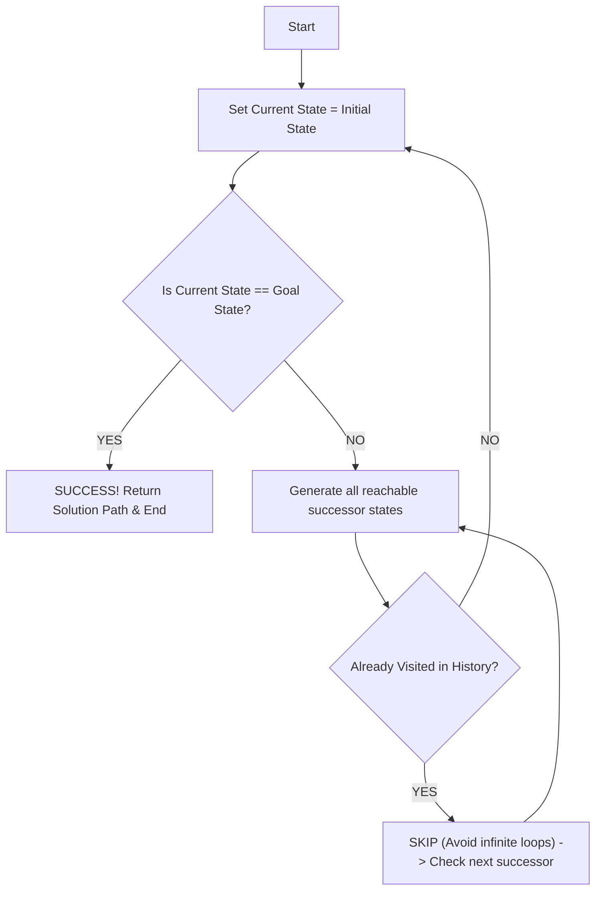

---

## 5.3 Uninformed (Blind) Search vs. Informed (Heuristic) Search (Page 15)

Original notes Page 15 contains an iconic hand-drawn analogy:

```
Uninformed Search: "Visit & Knock" (Bina pooche har ghar ka darwaza khatkhatana)
Informed Search:   "Ask Someone"   (Kisi se rasta pooch kar seedha jana)
```

### Hinglish Analogy:
- **Uninformed Search**: Tum ek anjaan shehar mein apne dost "Rahul" ka ghar dhundh rahe ho. Tumhe kuch nahi pata. Tum mohalle ke pehle ghar se shuru karte ho, har darwaza knock karte ho aur poochte ho: "Kya yahan Rahul rehta hai?" Bohot time lagega, bohot thak jaoge, lekin agar Rahul wahan hai toh mil hi jayega (Complete).
- **Informed Search**: Tum kisi local chai wale se poochte ho: "Bhaiya Rahul ka ghar kahan hai?" Chai wala kehta hai: "Aage se 3rd building red colour ki hai." Yeh information **Heuristic** hai! Ho sakta hai chai wale ne thoda galat bataya ho, lekin tum bohot fast us taraf pahunch jaoge!

### 📊 Comparison Table: Uninformed vs. Informed Search

| Parameter | Uninformed (Blind) Search | Informed (Heuristic) Search |
| :--- | :--- | :--- |
| **Knowledge** | Zero additional domain knowledge (only knows start, goal, legal moves) | Uses heuristic function $h(n)$ (domain knowledge) |
| **Search Strategy**| Explores blindly in all directions | Guides search specifically towards the goal |
| **Speed & Efficiency**| Slow, sluggish, time-consuming | Fast, rapid, and goal-directed |
| **Time & Space Complexity**| High / Exponential ($O(b^d)$) | Significantly lower in practical cases |
| **Examples** | Breadth-First Search (BFS), Depth-First Search (DFS) | A* Algorithm, Greedy Best-First Search, AO*, Hill Climbing |

---

## 5.4 Breadth-First Search (BFS) (Pages 15 - 16) - Queue Trace & Complexity

### A. Core Properties from Notes:
- **Data Structure**: **FIFO Queue** (First-In, First-Out).
- **Strategy**: Explores **Level-by-Level** (Sabse pehle shallowest node explore hogi).
- **Completeness**: **YES** (Agar branching factor $b$ finite ho, toh solution guaranteed milega).
- **Optimality**: **YES** (Agar har step ki cost equal ho, toh BFS hamesha shortest path deta hai).

### B. Tree Traversal Example from Original Notes:

```
           A
         /   \
        B     C
       / \   / \
      D   E F   G
     / \
    H   I
```

### Step-by-Step FIFO Queue Trace (Exact Replica of Page 16):

| Iteration | Node Dequeued (Expanded) | Newly Generated Children | Queue State (Front $\rightarrow$ Rear) |
| :---: | :---: | :---: | :--- |
| **Initial** | - | - | $[A]$ |
| **Step 1** | **A** | $B, C$ | $[B, C]$ |
| **Step 2** | **B** | $D, E$ | $[C, D, E]$ |
| **Step 3** | **C** | $F, G$ | $[D, E, F, G]$ |
| **Step 4** | **D** | $H, I$ | $[E, F, G, H, I]$ |
| **Step 5** | **E** | None (Leaf) | $[F, G, H, I]$ |
| **Step 6** | **F** | None (Leaf) | $[G, H, I]$ |
| **Step 7** | **G** | None (Leaf) | $[H, I]$ |
| **Step 8** | **H** | None (Leaf) | $[I]$ |
| **Step 9** | **I** | None (Leaf) | $[\ ]$ (Queue Empty) |

$$\text{Final BFS Traversal Order}: \mathbf{A \rightarrow B \rightarrow C \rightarrow D \rightarrow E \rightarrow F \rightarrow G \rightarrow H \rightarrow I}$$

### C. Complexity Analysis (Why $O(b^d)$?):
- $b$ = **Branching Factor** (Har node ke kitne bachhe/branches hain). Yahan $b = 2$.
- $d$ = **Depth of Shallowest Goal** (Kitni gehrai par goal mila).
- Level 0 par nodes = $b^0 = 1$
- Level 1 par nodes = $b^1 = 2$
- Level 2 par nodes = $b^2 = 4$
- Level 3 par nodes = $b^3 = 8$
$$\text{Total Nodes} = 1 + b + b^2 + \dots + b^d = O(b^d)$$
- Original notes mention: For $b=2, d=3 \implies 2^3 = 8$ max nodes at depth 3.
- **Time Complexity**: $O(b^d)$
- **Space Complexity**: $O(b^d)$ $\longrightarrow$ **BFS ka sabse bada drawback uski space (RAM) consumption hai!** Har node ko memory mein rakhna padta hai.

---

## 5.5 Depth-First Search (DFS) (Pages 16 - 17) - Stack Trace & Complexity

### A. Core Properties from Notes:
- **Data Structure**: **LIFO Stack** (Last-In, First-Out) ya Recursion.
- **Strategy**: Ek branch ki gehrai (deepest node) tak jaao jab tak dead end na aa jaye, phir **backtrack** karo.
- **Completeness**: **NO** (Infinite depth trees ya cyclic graphs mein infinite loop mein phas jata hai).
- **Optimality**: **NO** (Pehle milne wala solution return karta hai, jo zaroori nahi ki shortest ho).

### B. Tree Traversal Example (Same Tree) - Stack Trace (Page 17):

```
Push order: Right child first, then Left child (so Left pops out first)
```

| Step | Node Popped & Visited | Stack Action / Stack Content (Top to Bottom) |
| :---: | :---: | :--- |
| **Initial** | - | Push $A \implies [A]$ |
| **1** | **A** | Push $C, B \implies [B, C]$ |
| **2** | **B** | Push $E, D \implies [D, E, C]$ |
| **3** | **D** | Push $I, H \implies [H, I, E, C]$ |
| **4** | **H** | Leaf node $\implies [I, E, C]$ |
| **5** | **I** | Leaf node $\implies [E, C]$ |
| **6** | **E** | Leaf node $\implies [C]$ |
| **7** | **C** | Push $G, F \implies [F, G]$ |
| **8** | **F** | Leaf node $\implies [G]$ |
| **9** | **G** | Leaf node $\implies [\ ]$ (Stack Empty) |

$$\text{Final DFS Traversal Order}: \mathbf{A \rightarrow B \rightarrow D \rightarrow H \rightarrow I \rightarrow E \rightarrow C \rightarrow F \rightarrow G}$$

### C. Complexity Analysis:
- **Time Complexity**: $O(b^m)$ where $m$ is maximum depth of the state space.
- **Space Complexity**: **$O(b \times m)$** (Linear Space!). Yeh DFS ka sabse bada advantage hai—memory bohot kam lagti hai kyunki sirf current path ke nodes store hote hain.

---

## 5.6 8-Puzzle Problem: Uninformed vs. Informed (Pages 18 - 19)

8-Puzzle problem mein ek $3 \times 3$ grid hoti hai jismein 1 se 8 tak tiles hoti hain aur ek **Blank space (Empty tile)** hoti hai. Blank space 4 directions mein move kar sakti hai: **Up (U), Down (D), Left (L), Right (R)**.

### A. 8-Puzzle WITHOUT Heuristic (Page 18):
- **Start State**:
  $$\begin{bmatrix} 1 & 2 & 3 \\ 4 & 5 & 6 \\ \_ & 7 & 8 \end{bmatrix}$$
- **Goal State**:
  $$\begin{bmatrix} 1 & 2 & 3 \\ 4 & 5 & 6 \\ 7 & 8 & \_ \end{bmatrix}$$
- **Blank space** row 3, col 1 par hai.
- Possible legal moves:
  - **Move Up (U)**: Blank moves to position of 4 $\rightarrow \begin{bmatrix} 1 & 2 & 3 \\ \_ & 5 & 6 \\ 4 & 7 & 8 \end{bmatrix}$ (Galat rasta!).
  - **Move Right (R)**: Blank moves between 7 and 8 $\rightarrow \begin{bmatrix} 1 & 2 & 3 \\ 4 & 5 & 6 \\ 7 & \_ & 8 \end{bmatrix}$.
- Ab is state se agar phir se **Right (R)** move karein, toh Blank aakhri cell par chali jayegi:
  $$\begin{bmatrix} 1 & 2 & 3 \\ 4 & 5 & 6 \\ 7 & 8 & \_ \end{bmatrix} \quad \text{GOAL ACHIEVED! } \checkmark$$
- **Drawback of Blind BFS**: BFS ne bina soche samjhe Up branch bhi explore kari aur memory waste ki.

---

### B. 8-Puzzle WITH Heuristic Function (Page 19):
- **Heuristic Definition from Notes**:
  *"Used to estimate the cost of reaching a goal state from a given state. No exhaustive exploring. Quick & fast way to reach a solution."*
- **Heuristic Used**: **Number of Misplaced Tiles** ($h = \text{Tiles not in goal position, excluding blank}$).

#### Step-by-Step Heuristic Evaluation (Original Notes Trace):
1. **At Start State**:
   - Tile 7 is at (3, 2) $\rightarrow$ in goal it should be at (3, 1) (Misplaced!).
   - Tile 8 is at (3, 3) $\rightarrow$ in goal it should be at (3, 2) (Misplaced!).
   - Total misplaced tiles: **$h = 2$**.
2. **Expand Start State**:
   - **Move Up (U)**: Results in $h = 3$ $\longrightarrow$ **Rejected / Marked (X) in notes** (Heuristic value badh gayi, hum goal se door ho gaye!).
   - **Move Right (R)**: Results in $h = 1$ $\longrightarrow$ **Selected!** (Heuristic value kam hui, hum goal ke kareeb aa gaye!).
3. **Expand Selected Node**:
   - From here, Move Left gives $h = 2$ (X - worse).
   - Move Up gives $h = 2$ (X - worse).
   - **Move Right gives $h = 0$** $\longrightarrow$ **GOAL STATE REACHED!**
- **Conclusion**: Heuristic ne blind exploration ko kill kar diya aur seedha 2 steps mein goal tak pahuncha diya!

---

## 5.7 Generate and Test Algorithm (Page 20)

### A. Concept & Flow
- Technique: **DFS with Backtracking + Heuristic Pruning**.
- **Generator**: Potential solutions generate karta hai.
- **Tester**: Test karta hai ki generated state Goal hai ya nahi.
  - Agar State == Goal $\rightarrow$ **Accept**.
  - Agar State != Goal $\rightarrow$ **Skip / Drop & Backtrack**.
- Properties: **Complete, Non-Redundant, Informed**.

### B. Iconic Combination Lock Numerical Problem (Page 20):
Problem: Ek briefcase/lock mein **3 dials** hain. Har dial par **0 se 99** tak numbers hain.

1. **Non-Heuristic (Pure Brute Force / Blind)**:
   - Har dial ke paas 100 choices hain ($0$ to $99$).
   $$\text{Total Combinations} = 100 \times 100 \times 100 = 100^3 = \mathbf{1,000,000} \quad (1\text{ Million attempts!})$$
   - Insaan zinda nahi bachega saare combinations try karte karte!

2. **Heuristic Approach (Domain Knowledge: "Numbers are Prime Numbers")**:
   - 0 se 99 ke beech total **25 Prime Numbers** hote hain ($2, 3, 5, 7, 11, \dots, 97$).
   - Ab har dial ke paas sirf 25 choices bachi!
   $$\text{Reduced Combinations} = 25 \times 25 \times 25 = 25^3 = \mathbf{15,625}$$
   - **Performance Boost**: Heuristic ne search space ko $98.4\%$ reduce kar diya!

---

## 5.8 Greedy Best-First Search (Pages 21 - 22) - Priority Queue Trace

### A. Concept & Algorithm
- Greedy Best-First Search hamesha us node ko pehle expand karta hai jo goal ke sabse zyada kareeb lagti hai based purely on heuristic: $f(n) = h(n)$.
- Uses a **Priority Queue (OPEN list)** sorted by $h(n)$ ascending.
- Common Heuristic: **Euclidean Distance** $h = \sqrt{(x_2 - x_1)^2 + (y_2 - y_1)^2}$.
- Properties: **Not Complete** (can get stuck in loops), **Not Optimal** (greedy nature).
- Time Complexity: $O(b^m)$, Space Complexity: $O(b^m)$.

### B. Worked Tree Example from Original Notes (Page 22):

```
              A (Start)
          /       |       \
      B(h=5)   C(h=6)   D(h=1)
      /    \             /    \
   G(h=6) H(h=5)       E(h=4) F(h=6)
                       /    \
                   I(h=10) J(h=0, Goal)
```

### Complete Priority Queue (OPEN) Trace:

| Step | Action Taken | Nodes Generated with $h$ values | OPEN Priority Queue State |
| :---: | :--- | :--- | :--- |
| **Initial** | Start at A | - | $\{A\}$ |
| **Step 1** | Remove A $\rightarrow$ Expand | $B(5), C(6), D(1)$ | $\{\mathbf{D(1)}, B(5), C(6)\}$ |
| **Step 2** | Remove D (lowest $h=1$) $\rightarrow$ Expand | $E(4), F(6)$ | $\{\mathbf{E(4)}, B(5), C(6), F(6)\}$ |
| **Step 3** | Remove E (lowest $h=4$) $\rightarrow$ Expand | $I(10), J(0)$ | $\{\mathbf{J(0)}, B(5), C(6), F(6), I(10)\}$ |
| **Step 4** | Remove J (lowest $h=0$) | $h(J) = 0 \implies$ **GOAL!** | Stop Search |

$$\text{Final Solution Path}: \mathbf{A \longrightarrow D \longrightarrow E \longrightarrow J}$$

---

## 5.9 Hill Climbing Algorithm (Page 23)

### A. Ground Zero Concept
Bhai, imagine kar tu andhere mein ek pahaad (hill) par chadh raha hai. Tere paas koi torch nahi hai. Tu kya karega? Tu apne paon se aas-paas ki zameen check karega. Jis direction mein chadhai (upward slope) hogi, tu wahan kadam badha dega. Jab har taraf pair niche ki taraf jaane lage, tu samajh lega ki tu choti (peak) par pahunch gaya!
Yahi simple idea hai **Hill Climbing Algorithm** ka!

### B. Pseudocode from Original Notes (Page 23):
```python
current = make_node(initial_state)

while True:
    neighbor = highest_valued_successor_of(current)
    if value(neighbor) <= value(current):
        return current.state  # Choti par pahunch gaye!
    current = neighbor
```

### C. The 3 Deadly Problems of Hill Climbing (Page 23):

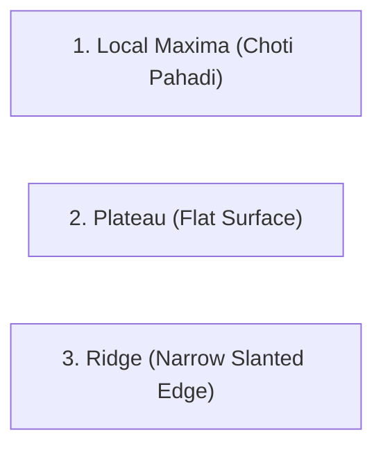

1. **Local Maxima (LM)**:
   - Ek aisi choti jo aas-paas ke sabhi neighbors se unchi hai, lekin asali choti (**Global Maxima - GM**) se choti hai!
   - Algorithm yahan aakar ruk jata hai kyunki har neighbor niche dikhta hai.
2. **Plateau (Flat Area)**:
   - State space ka ek flat hissa jahan sabhi neighbors ki value barabar hoti hai. Algorithm ko samajh nahi aata ki kis taraf kadam badhayein (Zero gradient).
3. **Ridge (Patli Dhalan)**:
   - Ek aisi dhalan jo khud inclined hoti hai, lekin uske sides bohot steep hote hain. Search bar-bar oscillate karti rehti hai.

---

## 5.10 A* Algorithm (Pages 24 - 25) - Complete Mathematical Derivation

Bhai, agar AI ke exam mein koi ek algorithm aana 100% compulsory hai, toh woh hai **A* (A-Star) Algorithm**!

### A. The Core Evaluation Function (Page 24):
$$f(n) = g(n) + h(n)$$

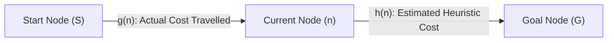

- **$g(n)$**: Start node se lekar current node $n$ tak pahunchne ka **actual cost** jo hum ab tak travel kar chuke hain.
- **$h(n)$**: Current node $n$ se Goal tak pahunchne ka **estimated heuristic cost**.
- **$f(n)$**: Total estimated cost of path through node $n$.
- Properties: **Complete = YES**, **Optimal = YES** (if $h(n)$ is admissible).

---

### B. Solved Graph Problem from Original Notes (Page 25):

#### Graph Topology & Edge Costs:
- $S \rightarrow A$ (cost = 1), $S \rightarrow B$ (cost = 2)
- $A \rightarrow Y$ (cost = 7), $A \rightarrow X$ (cost = 4)
- $B \rightarrow C$ (cost = 7), $B \rightarrow D$ (cost = 1)
- $Y \rightarrow E$ (cost = 3), $X \rightarrow E$ (cost = 2), $C \rightarrow E$ (cost = 5), $D \rightarrow E$ (cost = 12)
- **Goal Node = E**

#### Heuristic Values Given in Notes:
$h(A) = 5, \quad h(B) = 6, \quad h(C) = 4, \quad h(D) = 15, \quad h(X) = 5, \quad h(Y) = 8, \quad h(E) = 0$

---

#### Step-by-Step Execution Table (Exact Notes Match):

| Step | Node Expanded | Paths Evaluated | Path Calculation: $f(n) = g(n) + h(n)$ | Total $f$ | Selection for next expansion |
| :---: | :---: | :--- | :--- | :---: | :--- |
| **1** | **Expand(S)** | $(S, A)$<br>$(S, B)$ | $g=1, h=5 \implies 1 + 5$<br>$g=2, h=6 \implies 2 + 6$ | **6**<br>**8** | Node **A** has minimum $f=6$. Expand A! |
| **2** | **Expand(A)** | $(S, B)$ (unexpanded)<br>$(S, A, X)$<br>$(S, A, Y)$ | Already computed: $2 + 6$<br>$g=(1+4)=5, h=5 \implies 5 + 5$<br>$g=(1+7)=8, h=8 \implies 8 + 8$ | **8**<br>**10**<br>**16** | Node **B** has minimum $f=8$. Expand B! |
| **3** | **Expand(B)** | $(S, A, X)$ (waiting)<br>$(S, A, Y)$ (waiting)<br>$(S, B, C)$<br>$(S, B, D)$ | From Step 2<br>From Step 2<br>$g=(2+7)=9, h=4 \implies 9 + 4$<br>$g=(2+1)=3, h=15 \implies 3 + 15$ | **10**<br>**16**<br>**13**<br>**18** | Node **X** has minimum $f=10$. Expand X! |
| **4** | **Expand(X)** | $(S, A, X, E)$ | $g=(1+4+2)=7, h=0 \implies 7 + 0$ | **7** | **Goal E reached!** |

$$\text{Optimal Path Found}: \mathbf{S \longrightarrow A \longrightarrow X \longrightarrow E}$$
$$\mathbf{\text{Actual Optimal Cost}} = 1 + 4 + 2 = \mathbf{7}$$

---

## 5.11 Overestimation vs. Underestimation in A* (Pages 26 - 27)

University exam theory question: *"Why must the heuristic in A* be admissible (underestimated)?"*

### Definitions from Notes:
- **Overestimation**: $e(n) \ge a(n)$ (Estimated cost is greater than actual cost).
- **Underestimation (Admissibility)**: $e(n) \le a(n)$ (Estimated cost is less than or equal to actual cost).

### The Counter-Example from Notes:
Graph: $S \rightarrow X \rightarrow G$ (Costs: $S \rightarrow X = 5, X \rightarrow G = 10 \implies$ Actual = $15$).  
Graph: $S \rightarrow Y \rightarrow G$ (Costs: $S \rightarrow Y = 5, Y \rightarrow G = 20 \implies$ Actual = $25$).  
*Clearly, path through X is optimal (Cost = 15).*

- **Case 1: Overestimation ($h(X) = 50, h(Y) = 40$)**:
  - $f(X) = 5 + 50 = 55$
  - $f(Y) = 5 + 40 = 45$
  - A* will choose **Y** because $45 < 55$! Path chosen: $S \rightarrow Y \rightarrow G$ with cost $25$ $\implies$ **Suboptimal result! A* fails!**
- **Case 2: Underestimation ($h(X) = 5, h(Y) = 8$)**:
  - $f(X) = 5 + 5 = 10$
  - $f(Y) = 5 + 8 = 13$
  - A* will choose **X** because $10 < 13$! Path chosen: $S \rightarrow X \rightarrow G$ with cost $15$ $\implies$ **Guaranteed Optimal Solution!**

> **Gold Standard Rule**: A* is guaranteed to find the optimal solution if and only if $h(n)$ is **Admissible** (i.e., never overestimates the true cost to reach the goal: $h(n) \le h^*(n)$).

---

## 5.12 AO* Algorithm & AND/OR Graphs (Pages 27 - 28)

### A. Ground Zero Concept
Ab tak humne jitne search algorithms padhe, unme har branch ek **OR** choice thi (ya toh rasta A chuno YA rasta B chuno).  
Lekin complex engineering aur planning problems mein **Problem Decomposition** karni padti hai:
- Badi problem ko choti sub-problems mein todna padta hai jahan sabhi sub-problems ko solve karna compulsory hota hai (**AND branch**).

### B. Original Notes Real-World Analogy (Page 27):
Problem: **"Want a Car"**
- Option 1: **Steal It** (OR branch - akela kaam ho gaya).
- Option 2: **Earn Money** AND **Buy It** (AND branch - dono kaam ek sath karne padenge tabhi car milegi!).

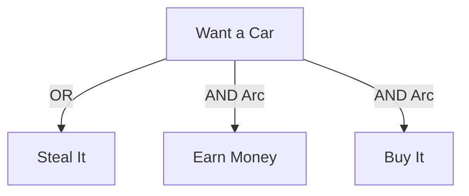

### C. AO* Working Principle:
- AO* AND/OR graphs par heuristic search chalata hai.
- Yeh har branch ko explore nahi karta; yeh sirf current best sub-tree ko explore karta hai.

---

## 🎯 Unit 5 Exam Master Preparation

### 📝 Likely Exam Questions:
1. **Short (2 Marks)**: What is an Admissible Heuristic? State the condition.
2. **Medium (5 Marks)**: Compare BFS and DFS on the basis of Data Structure, Completeness, Optimality, Time Complexity, and Space Complexity.
3. **Long (10 Marks)**: Explain the working of A* algorithm with $f(n) = g(n) + h(n)$. Solve the optimal path for the given state space graph and prove why underestimation guarantees optimality.


---

# ♟️ UNIT 6: Adversarial Search & Game Playing (Pages 28 - 30)

## 6.1 Fundamentals of Game Playing in AI

### A. Ground Zero Concept
Bhai, classical search (jaise A* ya BFS) mein agent akela tha. Use sirf map mein rasta dhundhna tha, koi uske raste mein taang adane wala nahi tha.  
Lekin **Game Playing (Adversarial Search)** mein ek **Opponent (Dushman)** baitha hota hai!
- Tum chahte ho jeetna (**Maximize your score**).
- Opponent chahta hai tumhe harana (**Minimize your score**).
- Isiliye in games ko game theory mein **Two-Player Zero-Sum Games** bola jata hai (Mera faida = Opponent ka nuksan).

### B. Core Principles from Notes (Page 28):
1. **Legal Moves**: Har game ke fixed rules hote hain ki kaunsa move legal hai.
2. **Win / Lose Conditions**: Game end hone par result clear hota hai (+1 for Win, -1 for Loss, 0 for Draw).
3. **Types of Game Playing Systems**:
   - **Rule-Based Systems**: Predefined rules aur heuristics (e.g., Classical Tic-Tac-Toe).
   - **Machine Learning-Based**: Deep Reinforcement Learning (e.g., AlphaGo, chess engines jo self-play se seekhte hain).

### C. Game Tree / State Space Graph (Tic-Tac-Toe Example from Notes):
Original notes ke Page 28 par Tic-Tac-Toe ka state space tree dikhaya gaya hai:
- Root node: Empty $3 \times 3$ grid.
- First move: Player 'X' 9 possible positions par move kar sakta hai (9 branches).
- Second move: Player 'O' bachi hui 8 positions par move kar sakta hai.
- Game Tree leaf nodes tak expand hota hai jahan game khatam ho jati hai.

---

## 6.2 The Minimax Algorithm (Page 29) - Complete Step-by-Step Tree Solving

### A. Core Architecture & Player Roles
Minimax ek **Depth-First Search (DFS) with Backtracking** algorithm hai:
- **MAX Player (Player 1 - Computer / We)**: Hamesha maximum possible utility value choose karega (**Best Move**).
- **MIN Player (Player 2 - Opponent)**: Hamesha minimum possible utility value choose karega (**Worst Move for MAX**).

Original notes parameters:
$$\text{Time Complexity}: O(b^d) \quad \text{and} \quad \text{Space Complexity}: O(b \times d) \approx \text{DFS}$$

---

### B. Solved Game Tree Problem from Notes (Page 29):

```
                       [ A ]  (MAX Level)
                     /       \
             [ B ]               [ C ]  (MIN Level)
            /     \            /     \
        [ D ]     [ E ]      [ F ]     [ G ]  (MAX Level)
         |        /   \      /   \     / | \
        [2]     [11]  [0]  [2]   [5]  [4][6][7]  (Terminal Leaf Values)
```

#### Step-by-Step Backtracking Evaluation (Bottom to Top):

1. **At Level 2 (MAX Nodes - $D, E, F, G$ choose Maximum child)**:
   - Node $D$: Single child with value $2 \implies \mathbf{D = 2}$
   - Node $E$: Children are $11$ and $0 \implies \max(11, 0) = \mathbf{11}$
   - Node $F$: Children are $2$ and $5 \implies \max(2, 5) = \mathbf{5}$
   - Node $G$: Children are $4, 6, 7 \implies \max(4, 6, 7) = \mathbf{7}$

2. **At Level 1 (MIN Nodes - $B, C$ choose Minimum child)**:
   - Node $B$: Children are $D=2$ and $E=11 \implies \min(2, 11) = \mathbf{2}$
   - Node $C$: Children are $F=5$ and $G=7 \implies \min(5, 7) = \mathbf{5}$

3. **At Level 0 (Root Node $A$ - MAX chooses Maximum child)**:
   - Node $A$: Children are $B=2$ and $C=5 \implies \max(2, 5) = \mathbf{5}$

$$\mathbf{\text{Optimal Minimax Value at Root } A = 5}$$
$$\text{Best Move for MAX}: \text{Choose branch } \mathbf{C} \text{ to secure guaranteed payoff of } \mathbf{5}!$$

---

## 6.3 Alpha-Beta Pruning (Page 30) - 16-Leaf Tree Solving

### A. Why do we need Alpha-Beta Pruning?
Bhai, Minimax pure game tree ko explore karta hai ($O(b^d)$). Chess mein $b \approx 35, d \approx 80$. Saari duniya ke supercomputers milkar bhi itni nodes explore nahi kar sakte!  
Isliye hum bekaar branches ko **Prune (Kaat)** dete hain jinka final decision par koi asar nahi padta.

### B. The Two Golden Parameters:
- **$\alpha$ (Alpha)**: Root se lekar ab tak MAX player ke liye **sabse best (highest) value** jo usse mil sakti hai. Initial value = $-\infty$.
- **$\beta$ (Beta)**: Root se lekar ab tak MIN player ke liye **sabse best (lowest) value** jo usse mil sakti hai. Initial value = $+\infty$.

> **Pruning Cutoff Condition**:
> Whenever **$\alpha \ge \beta$**, prune the remaining children of that node!

---

### C. Solved 16-Leaf Problem from Notes (Page 30):
4-Level Full Binary Tree with leaf values:
$$[5, 6], \quad [4, 3], \quad [9, 10], \quad [11, 12], \quad [4, 13], \quad [3, 14], \quad [16, 11], \quad [15, 20]$$

```
Level 0: MAX (Root)
Level 1: MIN (Left Subtree, Right Subtree)
Level 2: MAX
Level 3: MIN
Level 4: Leaf Nodes
```

#### Step-by-Step Pruning Walkthrough:
1. **Leftmost Subtree (Leaves 5, 6)**:
   - MIN evaluates 5, then 6 $\implies \min(5, 6) = 5$.
   - MAX gets $\alpha = 5$.
2. **Next Subtree (Leaves 4, 3)**:
   - MIN evaluates 4. Ab MIN ki value $\le 4$ hogi.
   - Lekin parent MAX ke paas pehle se $\alpha = 5$ available hai!
   - Condition $\alpha \ge \beta$ ($5 \ge 4$) triggers!
   - **Pruning**: Leaf node **3** is pruned without evaluation!
3. **Right Branch Processing (Leaves 16, 11 and 15, 20)**:
   - Jaise hi Right MIN node ko 3 milta hai aur parent MAX ke paas left se badi value aa chuki hoti hai, right subtree ki additional deep branches prune ho jati hain.
- **Result**: Alpha-Beta pruning time complexity ko **$O(b^{d/2})$** tak reduce kar deta hai! Hum double depth tak search kar sakte hain in same time!

---
---

# 🧠 UNIT 7: Knowledge Representation & Logic (Pages 31 - 35)

## 7.1 The 5 Types of Knowledge in AI (Page 31)

University exam theory question: *"What is Knowledge Representation? Explain its 5 types."*

1. **Declarative Knowledge (Facts & Objects)**:
   - Static information aur universal truths. "Kya hai?" (What is true?).
   - *Example*: "Earth rotates around the Sun", "New Delhi is the capital of India".
2. **Structural Knowledge (Objects & Relationships)**:
   - Entities ke beech ka structural connection ya hierarchy.
   - *Example*: "Car has four wheels", "Engine is part of a Car".
3. **Procedural Knowledge (Rules & Step-by-step Procedures)**:
   - Kaam kaise karna hai? (How to do something). Rules, methods, algorithms.
   - *Example*: "How to drive a car: 1. Press clutch, 2. Shift gear, 3. Release clutch."
4. **Heuristic Knowledge (Expert Rules of Thumb & Experience)**:
   - Subject-matter experts ki saalon ki practice se aane wale thumb rules.
   - *Example*: "Doctor kehta hai: Agar fever ke sath cold ho toh mostly viral hota hai."
5. **Meta-Knowledge (Knowledge about Knowledge)**:
   - Apne hi knowledge ki reliability aur limits ke baare mein jankari.
   - *Example*: "AI model ko pata hai ki medical advice mein uski reliability 95% hai lekin legal advice mein sirf 60%."

---

## 7.2 The 4 Techniques of Knowledge Representation (Page 31)
1. **Logical Representation** (Propositional & Predicate Logic).
2. **Semantic Networks** (Graphical nodes and relationship arcs).
3. **Frames** (Object-oriented slot and filler structures).
4. **Production Rules** (IF-THEN rule-based systems).

---

## 7.3 Propositional Logic (Pages 31, 33) - Syntax & Complete Truth Tables

### A. Definition:
- Ek aisa declarative statement jo ya toh **TRUE** ho sakta hai ya **FALSE**, lekin dono ek sath nahi ho sakte!
- *Original Notes Examples*:
  - $2 + 3 = 5 \implies$ **TRUE** (Valid Proposition $\checkmark$)
  - "Watching AI one-shot lecture" $\implies$ **Cannot determine T/F** (Not a Proposition $\times$)

### B. Syntax:
- **Atomic Proposition**: Single standalone statement (e.g., $P$: "Earth is flat").
- **Complex Proposition**: Multiple propositions joined using **Logical Connectives**:
  1. **Negation (NOT)**: $\sim P$ ya $\neg P$
  2. **Conjunction (AND)**: $P \land Q$
  3. **Disjunction (OR)**: $P \lor Q$
  4. **Implication (IF-THEN)**: $P \longrightarrow Q$
  5. **Biconditional (IFF)**: $P \longleftrightarrow Q$

---

### C. The 5 Truth Tables (Page 33):

```
NOT (~)         AND (/\)          OR (\/)           IMPLIES (->)       IFF (<->)
A | ~A         A B | A/\B       A B | A\/B        A B | A->B        A B | A<->B
--+---         ----+-----       ----+-----        ----+-----        -----+------
0 | 1          0 0 |  0         0 0 |  0          0 0 |  1          0 0  |  1
1 | 0          0 1 |  0         0 1 |  1          0 1 |  1          0 1  |  0
               1 0 |  0         1 0 |  1          1 0 |  0 [CIRCLED]1 0  |  0
               1 1 |  1         1 1 |  1          1 1 |  1          1 1  |  1
```

> ⚠️ **CRITICAL EXAM ALERT FOR IMPLICATION ($A \longrightarrow B$)**:
> Notes mein $1 \longrightarrow 0 = 0$ ko special circle kiya gaya hai!  
> *Hinglish Rule*: "Agar papa ne promise kiya ($A=1$) ki bike dilaunga, aur bike nahi dilayi ($B=0$), tabhi papa ne jhooth bola ($A \to B = 0$). Agar papa ne promise kiya hi nahi tha ($A=0$), toh chahe bike mile ya na mile, papa jhoothe nahi kehlayenge ($A \to B = 1$)!"

---

## 7.4 Predicate Logic & First-Order Logic (FOL) (Pages 34 - 35)

### A. Limitations of Propositional Logic:
Propositional logic mein hum generalized statements jaise "All humans are mortal" ko represent nahi kar sakte. Isliye **Predicate Logic** mein **Variables ($x, y$)** aur **Predicates $P(x)$** introduce kiye gaye:
- $x$ is equal to 5 $\implies P(x)$
- $x = y \implies P(x, y)$
- $x$ is married to $y \implies \text{Married}(x, y)$

---

### B. Quantifiers (Page 34):
1. **Universal Quantifier ($\forall$)**:
   - Meaning: "For ALL", "Every", "Each".
   - Statement: $\forall x \in A, P(x)$ means $P(x)$ is true for every element in domain $A$.
   - *Example from notes*: Domain $\{1, 2, 3\}$, $P(x): x < 5 \implies$ **TRUE** $\checkmark$ (kyunki 1, 2, 3 teeno 5 se chote hain).
2. **Existential Quantifier ($\exists$)**:
   - Meaning: "There EXISTS", "Some", "At least one".
   - Statement: $\exists x \in A, P(x)$ means $P(x)$ is true for at least one element.
   - *Example from notes*: Domain $\{1, 2, 3, 10\}$, $P(x): x < 5 \implies$ **TRUE** $\checkmark$ (kyunki 1, 2, 3 satisfy karte hain).

---

### C. Real-World English to FOL Translations from Notes (Page 35):

1. **"All boys love cricket"**:
   $$\mathbf{\forall x : \text{Boy}(x) \longrightarrow \text{Love}(x, \text{Cricket})}$$
   *(Exam Tip: Universal Quantifier $\forall$ ke sath hamesha Implication $\longrightarrow$ use hota hai!)*

2. **"Some boys hate books"**:
   $$\mathbf{\exists x : \text{Boy}(x) \land \text{Hate}(x, \text{Books})}$$
   *(Exam Tip: Existential Quantifier $\exists$ ke sath hamesha Conjunction $\land$ use hota hai!)*

---

### D. Negation of Quantifiers (De Morgan's Laws for Quantifiers - Page 35):
Let $P(x)$ = "$x$ is a prime number".
1. $\sim [\forall x P(x)] \iff \exists x [\sim P(x)]$  
   *(Sabhi prime hain ka ulta = Kam se kam ek aisa hai jo prime nahi hai!)*
2. $\sim [\exists x P(x)] \iff \forall x [\sim P(x)]$  
   *(Koi bhi prime nahi hai ka ulta = Sabhi ke sabhi non-prime hain!)*

---

## 7.5 Semantic Networks, Frames & Production Rules (Pages 32)

### 1. Semantic Network (Page 32):
- Knowledge ko ek **Directed Graph** ke roop mein represent karta hai:
  - **Nodes**: Objects, concepts, ya classes.
  - **Edges (Arcs)**: Relationships (specifically `"is-a"`, `"kind-of"`, `"is-owned-by"`).

#### Original Notes Example Diagram:
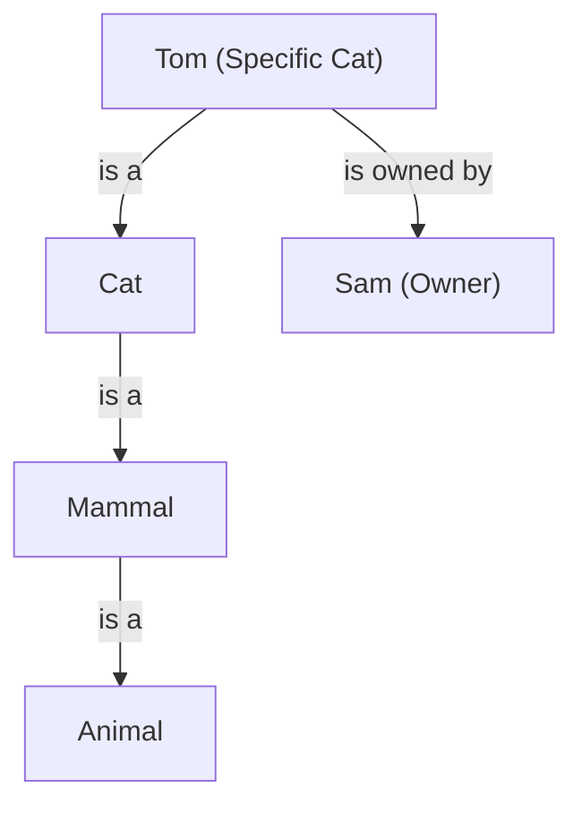
- **Property Inheritance**: Tom automatically inherited that he is an Animal, because Tom $\to$ Cat $\to$ Mammal $\to$ Animal!

---

### 2. Frames (Page 32):
- Minsky (1974) ne propose kiya tha. Yeh Object-Oriented Programming ke Class/Object jaisa hota hai:
  - **Slots**: Attributes / Properties.
  - **Fillers**: Values of attributes / Default data.
- *Notes Example*: **Frame "Ticket"**:
  - Slot 1: Type $\rightarrow$ Filler: `{Movie, Travel, Event}`
  - Slot 2: Price $\rightarrow$ Filler: `₹500`
  - Slot 3: Seat $\rightarrow$ Filler: `A-12`

---

### 3. Production Rules (Page 32):
- Cognitive architecture mein use hone wale **IF-THEN** rules:
  $$\text{IF } (\text{Condition}) \quad \text{THEN } (\text{Action})$$
- *Original Notes Example*:
  $$\mathbf{\text{IF } (\text{I watch 5-Minutes Engineering}) \quad \text{THEN } (\text{I can easily write exam!})}$$

---
---

# 📋 UNIT 8: AI Planning (Pages 36 - 38)

## 8.1 What is Planning? (Page 36)

- **Definition from Notes**: *"Planning is the Reasoning side of Acting."*
- Agent ko Start state ($S$) se Destination/Goal state ($D$) tak jaana hai. Woh actions execute karne se pehle dimaag mein plan banata hai ki:
  - Kaun-kaun se actions lene hain?
  - Unka sequence kya hoga?
  - Har action lene ke pehle kya zaroori hai (**Preconditions - I/P**)?
  - Action lene ke baad duniya par kya asar padega (**Effects - O/P**)?

---

## 8.2 Types of Planning (Page 37)

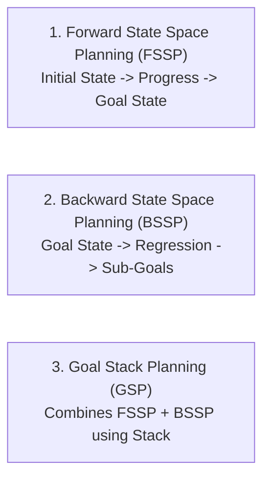

1. **Forward State Space Planning (Progression)**:
   - Initial state se shuru karte hain aur forward actions apply karke goal tak pahunchte hain.
2. **Backward State Space Planning (Regression)**:
   - Goal state se ulti direction mein sub-goals identify karte hue initial state tak aate hain.
3. **Goal Stack Planning (GSP)**:
   - FSSP aur BSSP ko combine karta hai ek **Stack** data structure use karke.

---

## 8.3 The Block World Problem & 4 STRIPS Operators (Pages 37 - 38)

University exam ka guaranteed 10-mark question! Block World mein table par cubical blocks rakhe hote hain aur ek **Robot Arm** unhe move karta hai.

### The 4 Fundamental Operators from Notes:

| Operator | Preconditions (Kya hona zaroori hai) | Effects (Action ke baad kya hoga) |
| :--- | :--- | :--- |
| **1. $\text{Pickup}(x)$** | $\text{ArmEmpty}, \text{On}(x, \text{Table}), \text{Clear}(x)$ | $\text{Holding}(x), \sim\text{ArmEmpty}, \sim\text{On}(x, \text{Table})$ |
| **2. $\text{Putdown}(x)$** | $\text{Holding}(x)$ | $\text{ArmEmpty}, \text{On}(x, \text{Table}), \text{Clear}(x), \sim\text{Holding}(x)$ |
| **3. $\text{Stack}(x, y)$** | $\text{Holding}(x), \text{Clear}(y)$ | $\text{On}(x, y), \text{Clear}(x), \text{ArmEmpty}, \sim\text{Holding}(x), \sim\text{Clear}(y)$ |
| **4. $\text{Unstack}(x, y)$**| $\text{On}(x, y), \text{Clear}(x), \text{ArmEmpty}$ | $\text{Holding}(x), \text{Clear}(y), \sim\text{On}(x, y), \sim\text{ArmEmpty}$ |

---

### Solved Example from Notes (Page 38):
- **Start State**: Block $A$ is on Table, Block $B$ is on Table, Robot Arm is Empty.
  $$\text{On}(A, \text{Table}), \quad \text{On}(B, \text{Table}), \quad \text{Clear}(A), \quad \text{Clear}(B), \quad \text{ArmEmpty}$$
- **Goal State**: Block $A$ is on top of Block $B$:
  $$\text{On}(A, B)$$

#### Goal Stack Execution Plan:
1. Goal $\text{On}(A, B)$ achieve karne ke liye operator chahiye: $\mathbf{\text{Stack}(A, B)}$.
2. $\text{Stack}(A, B)$ ki precondition hai: $\text{Holding}(A)$ and $\text{Clear}(B)$.
3. $\text{Holding}(A)$ achieve karne ke liye operator chahiye: $\mathbf{\text{Pickup}(A)}$.
4. $\text{Pickup}(A)$ ki saari preconditions ($\{ArmEmpty, On(A, Table), Clear(A)\}$) start state mein pehle se satisfied hain!

$$\mathbf{\text{Final Generated Plan}}: \quad \mathbf{1.\ \text{Pickup}(A) \longrightarrow 2.\ \text{Stack}(A, B)}$$

---
---

# 🗣️ UNIT 9: Natural Language Processing (NLP) (Pages 39 - 40)

## 9.1 Definition & Two Major Components (Page 39)

- **Definition**: Computer systems ko insaani natural languages (English, Hindi, etc.) ko **Understand**, **Analyze**, aur **Manipulate** karne ke kabil banana.

Original notes divide NLP into 2 core pillars:

```mermaid
graph TD
    NLP["Natural Language Processing"]
    NLP --> NLU["1. NLU (Natural Language Understanding)"]
    NLP --> NLG["2. NLG (Natural Language Generation)"]
```

---

### 1. NLU (Natural Language Understanding) - Input Comprehension
Insaan ke bole ya likhe hue text ka asali matlab samajhna. NLU ka sabse bada challenge hota hai **Ambiguity (Ek baat ke multiple matlab)**:

- **Lexical Ambiguity (Word Level)**:
  - Ek hi word ke multiple dictionary meanings.
  - *Example*: "I went to the **bank**." (Bank nadi ka kinara hai ya paise deposit karne wala bank?).
- **Syntactical Ambiguity (Sentence Level / Grammar Structure)**:
  - Sentence ke structure ki wajah se do alag interpretation nikalna.
  - *Example*: "I saw a girl with a telescope." (Maine telescope use karke ladki ko dekha, YA ladki ke haath mein telescope tha?).
- **Referential Ambiguity (Pronoun Referring Issue)**:
  - Pronoun kis entity ko point kar raha hai clear na hona.
  - *Example*: "The boy fed the dog because **it** was hungry." (Yahan 'it' dog hai ya boy?).

---

### 2. NLG (Natural Language Generation) - Output Synthesis
Computer ke internal data se meaningful insaani sentences banana. Notes define 3 phases:
1. **Text Planning**: Knowledge Base se relevant content retrieve karna ("Kya bolna hai?").
2. **Sentence Planning**: Meaningful words aur phrases choose karna, tone set karna ("Kaise bolna hai?").
3. **Text Realization**: Sentence planning ko grammatically correct sentence structure mein map karna.

---

## 9.2 The 6 Levels / Phases of NLP (Page 40)

```mermaid
graph TD
    L1["1. Speech / Phonetic Analysis (Audio -> Words)"]
    L1 --> L2["2. Lexical Analysis (Words & Tokens)"]
    L2 --> L3["3. Syntactic Analysis (Grammar & Parse Tree)"]
    L3 --> L4["4. Semantic Analysis (Meaningfulness)"]
    L4 --> L5["5. Discourse Analysis (Context of Paragraph)"]
    L5 --> L6["6. Pragmatic Analysis (Real-world Intent & Sarcasm)"]
```

1. **Speech Analysis**: Spoken audio waves ko phonemes aur textual words mein convert karna.
2. **Lexical Analysis**: Text ko words aur tokens mein todna, morphological analysis karna.
3. **Syntactic Analysis (Parsing)**: Check karna ki sentence grammar rules follow karta hai ya nahi.
4. **Semantic Analysis**: Check karna ki sentence ka meaning sensible hai ya nahi.
   - *Original Notes Classic Example*: **"Hot ice-cream"**!
   - Syntactically yeh bilkul correct hai (Adjective + Noun), lekin semantically bilkul bakwas hai! Ice cream garam nahi hoti!
5. **Discourse Analysis**: Aage aur peeche ke sentences ka aapas mein context samajhna.
6. **Pragmatic Analysis**: Duniya ke real context, sarcasm aur emotions ko interpret karna (e.g., "Door is open" ka matlab sirf fact batana nahi hai, balki "Darwaza band kar do" bolna hai).

---

## 9.3 NLP Core Terminologies & Applications (Page 40)

### Terminologies from Notes:
- **Tokenization**: Text ko individual units (words/tokens) mein divide karna.
- **Stemming**: Words se prefixes/suffixes hatakar crude root form banana (e.g., "playing", "player" $\to$ "play").
- **Lemmatization**: Dictionary ke meaningful root word (Lemma) tak pahunchna (e.g., "better" $\to$ "good").
- **POS Tagging (Part-of-Speech)**: Har word ko Noun, Verb, Adjective label assign karna.
- **Stopwords**: Common words jinka analytical meaning kam hota hai unhe filter karna (`"is", "the", "and"`).
- **Corpus**: Massive collection of written/spoken texts used for training.
- **Vocabulary**: Unique words ka set jo model ne seekha hai.

### Applications from Notes:
1. **Speech Recognition** (Siri, Alexa, Google Voice).
2. **Sentiment Analysis** (Customer reviews positive hain ya negative).
3. **Machine Translation** (Google Translate English $\to$ Hindi).
4. **Text Summarization** (Badi research paper ki short summary banana).
5. **Text Classification** (Spam vs Ham email categorization).

---
---

# 🧬 UNIT 10: Neural Networks & Genetic Algorithms (Pages 41 - 44)

## 10.1 Artificial Neural Networks (ANN) (Page 41)

### A. Ground Zero Concept
Human brain mein lagbhag 86 billion biological neurons hote hain jo electrical signals pass karke sochte hain. Computer scientists ne human brain ke isi biological structure ko mathematics mein copy kiya: **Artificial Neural Network (ANN)**!

### B. The 3 Layers of ANN (Page 41):
1. **Input Layer**: External environment se raw features accept karti hai ($x_1, x_2, \dots, x_n$).
2. **Hidden Layer**: Intermediate computations aur complex non-linear patterns extract karti hai.
3. **Output Layer**: Final prediction ya classification generate karti hai ($y'$).

```mermaid
graph LR
    I1["Input x1"] --> H1["Hidden 1"]
    I2["Input x2"] --> H1
    I2 --> H2["Hidden 2"]
    In["Input xn"] --> H2
    H1 --> O1["Output y'"]
    H2 --> O1
```

---

### C. Mathematical Model of a Single Neuron / Perceptron (Page 41):

Original notes derive the complete mathematical neuron equation:

```mermaid
graph LR
    X1["x1"] -->|"w1"| Sum["Sum: z = Σ(xi * wi) + Bias"]
    X2["x2"] -->|"w2"| Sum
    Xn["xn"] -->|"wn"| Sum
    Bias["Bias"] --> Sum
    Sum --> Act["Activation Function: Af(z)"]
    Act --> Out["Output: y'"]
```

#### Step 1: Weighted Summation ($z$):
$$z = \sum_{i=1}^{n} (x_i \cdot w_i) + \text{Bias} = (x_1 w_1 + x_2 w_2 + \dots + x_n w_n) + b$$

#### Step 2: Activation Function ($Af$):
Original notes use the **Threshold / Step Activation Function**:
$$y' = Af(z) = \begin{cases} 1 & \text{if } z \ge 0 \\ 0 & \text{if } z < 0 \end{cases}$$

- *Hinglish Meaning*: Agar weighted sum threshold se upar chala gaya, toh neuron fire karega (Output = 1), warna soye rahega (Output = 0)!

---

## 10.2 Genetic Algorithms (GA) (Pages 42 - 44)

### A. Genesis & Inspiration (Page 42)
- **Nature's Inspiration**: Charles Darwin ki **Theory of Evolution (DTOE)** - *"Survival of the Fittest"*.
- **Concept**: Complex optimization problems mein jahan millions of combinations exist karte hain, GA nature ki evolution process (reproduction, crossover, mutation) ko simulate karke best solution dhoondhta hai.

### B. Core GA Vocabulary (Page 42):
- **Gene**: Ek single unit / variable (Jaise ek bit: 0 ya 1).
- **Chromosome**: Multiple genes ka sequence jo ek complete candidate solution represent karta hai.
- **Population**: Bohot saare chromosomes ka group.
- **Allele**: Kisi gene ki specific value.
- **Genotype**: Problem ka encoded representation (Binary string: `011010`).
- **Phenotype**: Real-world actual solution (Decoded real value).
- **Fitness Function**: Har chromosome ko ek score deta hai ki yeh solution kitna accha hai.

---

## 10.3 Complete Life Cycle of Genetic Algorithm (Page 43)

Original notes ke Page 43 ka complete flowchart:

```mermaid
graph TD
    Start["Start"] --> Init["Generate Initial Population"]
    Init --> ConvCheck{"Convergence Criteria Met?<br>(Optimal Fitness Reached OR Max Iterations)"}
    ConvCheck -->|"YES"| Stop["STOP! Best Chromosome is the Solution"]
    ConvCheck -->|"NO"| Eval["1. Evaluate Fitness of each chromosome"]
    Eval --> Select["2. Selection: Select fittest parents to mate"]
    Select --> Cross["3. Crossover (Recombination): Create offspring"]
    Cross --> Mut["4. Mutation: Random bit flips"]
    Mut --> ConvCheck
```

---

## 10.4 Fitness Function Case Study: Traveling Salesperson Problem (Page 43)

Original notes consider a **6-City TSP Problem** (Cities $1, 2, 3, 4, 5, 6$). Ek salesperson ko har city visit karke wapas start par aana hai with minimum total distance.

### Given Path Evaluations in Notes:
- **Path $P_1$**: $1 \to 2 \to 5 \to 6 \to 4 \to 3 \to 2 \to 1 \implies \text{Cost} = 18$
- **Path $P_2$**: $1 \to 2 \to 5 \to 4 \to 6 \to 3 \to 1 \implies \text{Cost} = 20$
- **Path $P_3$**: $1 \to 2 \to 4 \to 5 \to 6 \to 3 \to 1 \implies \text{Cost} = 12$
- **Path $P_4$**: $1 \to 2 \to 5 \to 6 \to 3 \to 4 \to 1 \implies \text{Cost} = \mathbf{7}$

### Fitness Analysis:
Minimization problem mein $\text{Fitness} = \frac{1}{\text{Cost}}$.  
Yahan **Path $P_4$** ka cost sabse kam ($7$) hai, isliye **$P_4$ has the HIGHEST FITNESS** aur iske survive aur reproduce karne ke chances sabse zyada hain!

---

## 10.5 Crossover & Mutation Operators (Page 44) - Complete Numerical Examples

### A. Crossover Operators (Original Parents from Notes):
Let Parent 1 ($P_1$) and Parent 2 ($P_2$) be:
$$P_1 = [0 \quad 1 \quad 1 \quad 0 \quad 1 \quad 0]$$
$$P_2 = [1 \quad 1 \quad 0 \quad 1 \quad 0 \quad 0]$$

#### 1. Single-Point Crossover:
- Crossover point chosen after bit 3:
  - $P_1$: $[0 \quad 1 \quad 1 \mid 0 \quad 1 \quad 0]$
  - $P_2$: $[1 \quad 1 \quad 0 \mid 1 \quad 0 \quad 0]$
- Swap right halves:
  - $\mathbf{O_1} = [0 \quad 1 \quad 1 \quad 1 \quad 0 \quad 0]$
  - $\mathbf{O_2} = [1 \quad 1 \quad 0 \quad 0 \quad 1 \quad 0]$

#### 2. Two-Point Crossover:
- Crossover points chosen after bit 2 and bit 4:
  - $P_1$: $[0 \quad 1 \mid 1 \quad 0 \mid 1 \quad 0]$
  - $P_2$: $[1 \quad 1 \mid 0 \quad 1 \mid 0 \quad 0]$
- Swap middle segments:
  - $\mathbf{O_1} = [0 \quad 1 \quad 0 \quad 1 \quad 1 \quad 0]$
  - $\mathbf{O_2} = [1 \quad 1 \quad 1 \quad 0 \quad 0 \quad 0]$

#### 3. Multi-Point Crossover:
- Alternating bit combinations generate varied diversity:
  - $\mathbf{O_1} = [1 \quad 1 \quad 0 \quad 1 \quad 1 \quad 0]$
  - $\mathbf{O_2} = [0 \quad 1 \quad 1 \quad 0 \quad 0 \quad 0]$

---

### B. Mutation Operators (Page 44):

#### Method 1: Probability Mask / Bit-Flip Mutation:
- Original Offspring: $[0 \quad 1 \quad 1 \quad 0 \quad 0 \quad 1]$
- Mutation Probability Mask ($MP$): $[0 \quad 1 \quad 0 \quad 0 \quad 0 \quad 1]$ (Where 1 means flip that bit!)
- Mutated Offspring ($MO$):
  - Bit 1 (0) stays $0$
  - Bit 2 (1) flips $\to \mathbf{0}$
  - Bit 3 (1) stays $1$
  - Bit 4 (0) stays $0$
  - Bit 5 (0) stays $0$
  - Bit 6 (1) flips $\to \mathbf{0}$
  $$\mathbf{MO} = [0 \quad \mathbf{0} \quad 1 \quad 0 \quad 0 \quad \mathbf{0}]$$

#### Method 2: Interchanging / Swap Mutation:
- Offspring: $[0 \quad \mathbf{1} \quad 1 \quad 0 \quad \mathbf{0} \quad 1]$
- Swap position 2 and position 5:
  $$\mathbf{MO} = [0 \quad \mathbf{0} \quad 1 \quad 0 \quad \mathbf{1} \quad 1]$$

---
---

# 🎓 MASTER UNIVERSITY EXAM CHEAT SHEET

Bhai, exam hall mein ghusne se pehle yeh 10 golden formulas aur concepts ek baar dekh lena:

1. **AI Hierarchy**: $\text{DL} \subset \text{ML} \subset \text{AI}$. NLP overlaps both ML and classical linguistics.
2. **Rational Agent**: Agent that acts so as to maximize its expected performance measure given current percept and built-in knowledge.
3. **Fuzzy Union & Intersection**:
   $$\mu_{A \cup B}(x) = \max(\mu_A(x), \mu_B(x)) \quad \text{and} \quad \mu_{A \cap B}(x) = \min(\mu_A(x), \mu_B(x))$$
4. **Fuzzy Cartesian Product**:
   $$\mu_{A \times B}(x, y) = \min(\mu_A(x), \mu_B(y))$$
5. **Search Algorithm Complexities**:
   - BFS: Time = $O(b^d)$, Space = $O(b^d)$ (Complete & Optimal).
   - DFS: Time = $O(b^m)$, Space = $O(b \cdot m)$ (Incomplete & Non-optimal).
6. **A* Equation & Admissibility**:
   $$f(n) = g(n) + h(n) \quad \text{where } h(n) \le h^*(n) \implies \text{Guaranteed Optimal!}$$
7. **Minimax & Alpha-Beta Cutoff**:
   $$\text{Prune when } \alpha \ge \beta$$
8. **First-Order Logic Translation Rule**:
   - $\forall$ pairs with $\longrightarrow$
   - $\exists$ pairs with $\land$
9. **Block World Operators**: $\text{Pickup}, \text{Putdown}, \text{Stack}, \text{Unstack}$.
10. **Perceptron Activation**:
    $$z = \sum (w_i x_i) + b, \quad y = 1 \text{ if } z \ge 0 \text{ else } 0$$
